# AI in Excel Using ChatGPT & Copilot — Course Notes

These notes follow the course as it was delivered, in the same order. The worked examples use the course files:

- **AiAndExcelData.xlsx**, the main workbook (one tab per exercise)
- **AiAndExcel_Errors.xlsx**, a workbook with deliberate mistakes, used in the last demo

Tools: **ChatGPT** (chatgpt.com in a browser) and **Microsoft Copilot** (the app that comes with Microsoft 365). Everything except Section 10 works on the free versions.

> AI does not give the same answer every time. If you type the prompts below you may get a slightly different formula from the one shown. That is normal. Test whatever you get.

---

## 1. Understanding AI before you use it

### Where the answers come from
Every AI system is trained on a huge body of text, called the **corpus** or training data, and most of it comes from the internet. Some of that material is excellent, some is doubtful and some is simply wrong. A second component, **natural language processing**, lets the AI understand and write ordinary English. Put the two together and you get a **large language model (LLM)**, which is what ChatGPT and Copilot are.

### Six things to keep in mind

| Limitation | What it means | Seen in class |
|---|---|---|
| **It can be wrong** | Both tools say so on screen: *"AI-generated content may be incorrect"* | Different counts for the number of countries in Europe |
| **It is not deterministic** | The same question can give a different answer on a different day | Anywhere from 44 to 51 countries in Europe, depending on the day |
| **Sources aren't clear** | You often can't tell where an answer came from | Copilot cited one website. ChatGPT cited nothing |
| **Out of date** | The training data can lag behind the real world | Ireland's population; Bulgaria's currency (it has used the euro since 1 Jan 2026) |
| **Bias** | The source material may be one-sided | DeepSeek and Grok both lean in particular directions |
| **Hallucination** | It may invent plausible-looking facts | A list of Cork Tesco stores that included stores that don't exist |

Performance varies too. When the service is busy (usually in the afternoon, once the US is online), answers get slower, shorter and less reliable. You can check OpenAI's status at **status.openai.com**. Microsoft doesn't publish an equivalent page for Copilot.

> **Key principle:** treat AI as a capable assistant, not an infallible oracle. Check everything it gives you. In Excel that's easy, because you can see the formula and test it.

**Tips**
- Try a "test question" in two different AIs and compare the answers.
- Ask for populations or currencies to get a rough idea of how current the information is.
- If one tool is having a bad day, switch to the other, start a **new chat**, or try again later.

---

## 2. The parts of a prompt

The more of these parts you include, the better and more consistent the answers tend to be.

| Part | Question it answers | Example |
|---|---|---|
| **Context** | Who are you and what are you trying to do? | *I'm working with Excel.* / *I'm an accountant.* |
| **Persona** | Who should the AI be? | *Act as an Excel expert.* |
| **Request** | What do you want? Be clear, unambiguous and concise | *Give me a formula to calculate compound interest.* |
| **Examples** | What does a good answer look like? | *…for example INV1001* |
| **Constraints** | What are the limits? | *Under 150 words.* / *No VBA.* |
| **Technique / method** | How should it be done? | **"Give me step-by-step instructions"**, the most useful phrase for Excel work |
| **Data** | What should it work on? | Pasted values, a screenshot or an uploaded file |
| **Delimiter** | Where does the prompt end and the data begin? | Press **Shift+Enter** to start a new line without sending the prompt |
| **Tone** | How should it sound? | *Plain English, for a non-technical audience.* |
| **Format** | How should the answer be laid out? | Numbered list, table, bullet points, CSV |

The demonstration: *"I'm a psychologist. What does NLP stand for?"* gets the answer **Neuro-Linguistic Programming**. *"I'm a computer programmer…"* gets **Natural Language Processing**. One line of context completely changed the answer.

"Prompt engineering" is really just good human communication. Mix up the instruction and the data and you get the AI equivalent of a birthday cake iced with *"Happy Birthday Adam with Blue Flowers"*.

---

## 3. Formulas with AI

### 3.1 Create a formula: compound interest
**Tab: Compound Interest**

The prompt (note how precise the cell references are):

```text
I'm thinking of taking out a loan and I'm working with Excel.
I want you to be an Excel expert.
Can you give me a formula to calculate compound interest.
The principal is in B2, the rate is in C2, the term in months is D2
and the compounding interval is E2 (annually, quarterly, monthly or weekly).
```

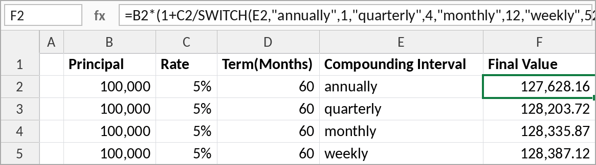

A typical answer (this returns the final value, i.e. principal plus interest):

```excel
=B2*(1+C2/SWITCH(E2,"annually",1,"quarterly",4,"monthly",12,"weekly",52))
   ^(SWITCH(E2,"annually",1,"quarterly",4,"monthly",12,"weekly",52)*D2/12)
```

For the **interest only**, subtract the principal: `=F2-B2`.

**Sanity checks we did**
- 5% of €100,000 is €5,000 a year. Over 5 years that's about €25,000 plus some compounding, so **€127,628** for annual compounding is in the right ballpark.
- More frequent compounding should mean more interest (annually < quarterly < monthly < weekly). ✔
- You may get a different but equivalent formula. The prompt didn't say "final value" or "interest", so be specific.

> **Tip:** always give the AI the exact cells, sheet name and table name. You get back a formula you can paste straight in, without having to adapt something you found on the internet.

### 3.2 Explain a formula
You've been given a spreadsheet with no documentation and a formula you don't understand. Paste it in and ask:

```text
Can you tell me what the following formula does?
=LET(a,range1,b,range2,countA,ROWS(a),countB,ROWS(b),seq,SEQUENCE(countA+countB),
     IF(seq<=countA,INDEX(a,seq),INDEX(b,seq-countA)))
```
*(the "combine ranges" example from exceljet.net)*

The AI answered: *"This formula combines two vertical ranges into one continuous list, placing range 2 directly underneath range 1."* That was short, concise and correct. It also pointed out that a newer function, **VSTACK**, does the same job.

### 3.3 Debug a formula
We pasted the formula into F2 and got `#NAME?`. The follow-up prompt:

```text
I've pasted this formula into cell F2 and I get #NAME?. What do I do?
```

The AI correctly spotted that `range1` and `range2` are placeholders that have to be replaced with real ranges, e.g. `A2:A7` and `C2:C5`.

### 3.4 The LET function
Quick poll in class: most people hadn't used **LET** (added around 2019–2020). It lets you **name values or calculations inside a formula** and reuse them, breaking a complex calculation into steps.

How it's built: pairs of *name, value*, followed by a final result.

```excel
=LET(a, 10,
     b, 20,
     a + b)
```

> **Tip:** press **Alt+Enter** inside the formula bar to put each step on its own line. You can also drag the formula bar to make it taller.

We rebuilt the combine-ranges formula one step at a time:

```excel
=LET(a,    A2:A7,                    step 1: first range
     b,    C2:C5,                    step 2: second range
     lenA, ROWS(a),                  step 3: 6 rows
     lenB, ROWS(b),                  step 4: 4 rows
     s,    SEQUENCE(lenA+lenB),      step 5: 1..10 (a dynamic array that spills)
     IF(s<=lenA, INDEX(a,s), INDEX(b,s-lenA)))
```

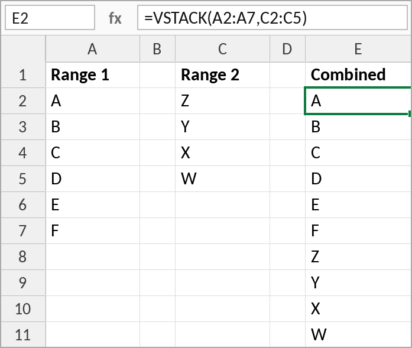

**Why LET matters.** We asked: *"Can you rewrite this formula without using the LET function?"* The rewritten version calls `ROWS(A2:A7)` five times, `ROWS(C2:C5)` three times and `SEQUENCE` three times. On 10,000 rows that repetition can slow a workbook down. LET calculates each value once.

Even if you never write LET yourself, **learn to recognise it**. AI answers use it a lot.

**The modern replacement.** The AI's own recommendation:

```excel
=VSTACK(A2:A7,C2:C5)
```

**What AI did with formulas:** created one, explained one, debugged one, explained a function inside one, rewrote one in an older style, and suggested a modern replacement.

---

## 4. A to-do list with checkboxes
**Tab: ToDo**

The prompt is plain English and doesn't mention any Excel feature by name:

```text
I have a sheet called ToDo. Column A1 to A10 contains to-do items.
Can you give me step-by-step instructions to add checkboxes to B1 to B10
and cross out the text in the corresponding cell in column A if the checkbox is checked.
```

| Before | After |
|---|---|
| 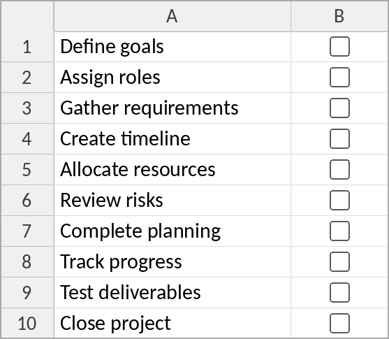 | 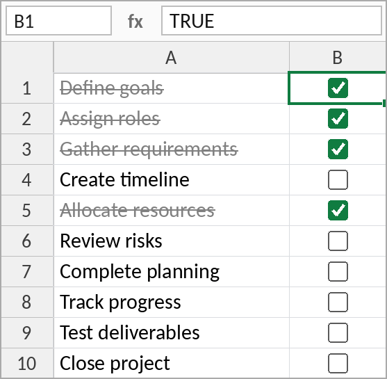 |

**Steps (as the AI gave them)**
1. Select **B1:B10** and choose **Insert > Checkbox**.
2. Select **A1:A10**, then go to **Home > Conditional Formatting > New Rule > Use a formula to determine which cells to format**.
3. Enter the formula:
   ```excel
   =$B1=TRUE
   ```
4. Click **Format… > Font** tab, tick **Strikethrough** (and optionally choose a grey colour), then click **OK** and **OK** again.

**About the new checkboxes**
- These are **native in-cell checkboxes**. They arrived quietly in Microsoft 365 around mid-2025. The cell's value is just **TRUE** or **FALSE**.
- You can copy them, fill them down, and they extend automatically in a table.
- ⚠️ If the AI tells you to use **Developer > Insert > Form Control > Check Box**, that answer is **out of date**. Those older checkboxes have to be linked to a cell one at a time, and they're easy to get wrong (see Error 3 in Section 11).

> **Key lesson:** describe the *result* you want. You don't need to know the name of the feature (conditional formatting, here).

---

## 5. XLOOKUP and dropdown lists
**Tab: XLOOKUP**

> **Tip:** you don't have to describe your data. **Take a screenshot** (e.g. with Snipping Tool) and paste it into the prompt. AI is very good at reading images.

```text
I have a sheet with the attached data [screenshot].
Can you give me a formula that will look up the product name for the product ID in cell F2?
```

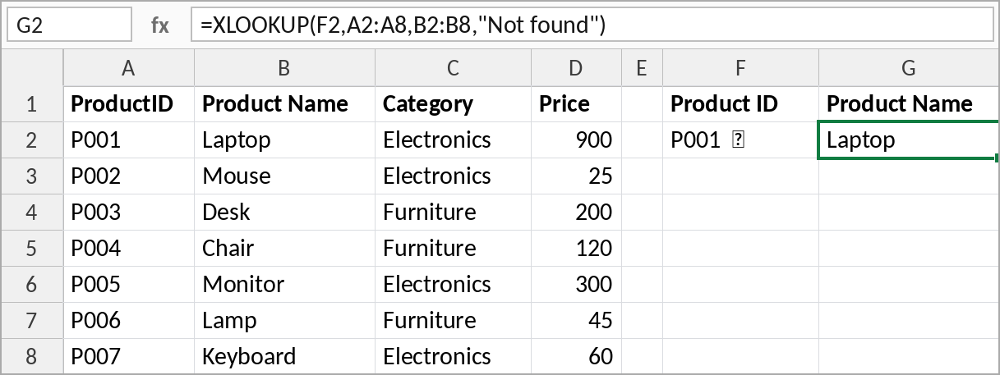

```excel
=XLOOKUP(F2,A2:A8,B2:B8,"Not found")
```

Testing it: P001 → Laptop, P007 → Keyboard, P004 → Chair, P999 → *Not found*. ✔

**XLOOKUP vs VLOOKUP**

| | VLOOKUP | XLOOKUP |
|---|---|---|
| Not-found message | Needs wrapping in `IFNA`/`IFERROR` | Built in (4th argument) |
| Look-up column | Must be the first column | Any column, including to the left |
| Default match | Approximate (risky) | **Exact** (safer) |
| Columns returned | One | One or several |

If you still use VLOOKUP, AI will usually give you XLOOKUP instead. That's a good opportunity to update your habits.

### Turn F2 into a dropdown
```text
Can you give me step-by-step instructions to convert cell F2 into a drop down?
```
1. Select **F2** and go to **Data > Data Validation** (in the *Data Tools* group; the icon has a tick and a no-entry sign).
2. Set **Allow** to **List**.
3. Set **Source** to `=$A$2:$A$8`.
4. Make sure **In-cell dropdown** is ticked, then click **OK**.

Users can now only choose a valid product ID. Typing anything else brings up an error.

---

## 6. Exercise: progress tracker
**Tab: Progress**

**Task:** put a checkbox under each stage (Plan, Approve, Execute, Review, Complete) for each job, and get AI to give you a formula for the percentage complete.

```text
I have five checkboxes in cells B2 to F2. Can you give me a formula that will calculate
a percentage complete for these checkboxes? If one box is ticked that would be 20%,
if all five boxes are checked it would be 100%.
```

```excel
=COUNTIF(B2:F2,TRUE)/COLUMNS(B2:F2)
```
Format it as a percentage, then fill the checkboxes and the formula down.

**Extension.** We asked: *"Could you suggest a graphical way of showing the percentage?"* The AI offered several options (data bars, conditional formatting and so on). The one we used was a text progress bar built with **REPT**, which repeats a character *n* times:

```excel
=REPT("█",ROUND(G2*10,0))&REPT("░",10-ROUND(G2*10,0))
```

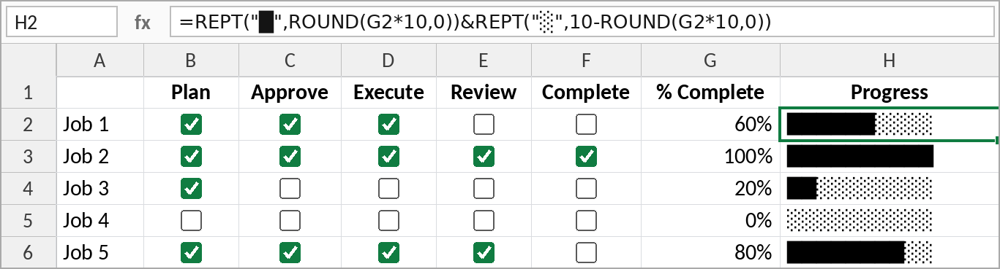

---

## 7. Excel Tables and structured references
**Tab: ProjectTasks**

```text
I have some data in a sheet called Project Tasks. Should I convert this to a table?
Can you tell me how to convert it to a table?
Can you tell me the features of a table?
```

**Create a table:** click anywhere in the data and press **Ctrl+T**. Check that the range is correct and that **My table has headers** is ticked, then click **OK**.

**Features**
- **Automatic expansion**: type in the row below and the table grows. Formulas and checkboxes fill down automatically.
- **Filter and sort** buttons on every header.
- **Styles**: choose one on the **Table Design** tab or create your own. Banded rows make long lists much easier to read.
- **Total row**: Sum, Count, Average, Max or Min (Table Design > Total Row).
- **Name your table.** Go to **Table Design > Table Name** and give it a meaningful name such as `ProjectTasks`. *Table1*, *Table2* and *Table3* are terrible names.

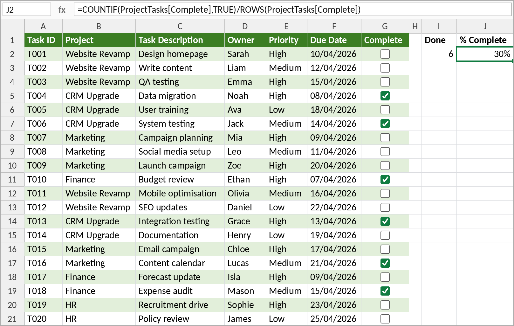

### Structured references
These two formulas do exactly the same job:

```excel
=COUNTIF(G2:G21,TRUE)
=COUNTIF(ProjectTasks[Complete],TRUE)
```

The second one tells you exactly what it's counting: the *Complete* column of the *ProjectTasks* table. It works the same way from any other sheet, and it **never needs to change** as rows are added. A traditional `G2:G21` reference has to be rewritten every time (Excel does this for you, but it's still a change to the formula).

The percentage complete formula the AI gave us:

```excel
=COUNTIF(ProjectTasks[Complete],TRUE)/ROWS(ProjectTasks[Complete])
```

We checked it: ticking every box gives 100%, and adding a new row (T023) drops it to 96%.

> If you're working with a table, AI will almost always give you structured references, so it's worth getting comfortable with them.

---

## 8. Power Query
Quick poll: most delegates hadn't used Power Query. The question we set out to answer was *"Can AI take me from never having used an advanced feature to using it, with nothing but step-by-step instructions?"* The answer was yes.

(This section was done in **Copilot**, to show that it works just as well as ChatGPT for Excel.)

```text
I'm working with Excel. I want you to be an Excel expert. What is Power Query?
```

**What Power Query is:** Excel's built-in **ETL** tool (Extract, Transform, Load). It **connects** to data, **cleans** and **transforms** it, **combines** it, and lets you **refresh** it next week or next month. It has been part of Excel since about 2017; it's no longer a separate add-in.

**Sources include:** Excel and CSV files, databases, websites and APIs, SharePoint, even PDFs (we used this to pull figures out of an ERP system's PDF reports).

### 8.1 Import data from a website
The course website returns customer data in **JSON** format (readable *"column": "value"* records).

```text
Can you give me step-by-step instructions to get data from this URL:
https://api.acodingtutor.com/customers
The data looks like this: [paste two or three records]
```

1. **Data > Get Data > From Other Sources > From Web**, paste the URL, then **OK**.
2. In the Power Query Editor, click **To Table** on the ribbon and accept the defaults.
3. Click the **expand** button (the two arrows in the *Column1* heading). Leave all the columns selected and **untick "Use original column name as prefix"**.
4. Check the data types, then go to **Home > Close & Load**.

Whatever the source, once you've connected the steps are the same.

**What you get**
- A **table**, named after the query (e.g. `Customers`), so structured references work: `=ROWS(Customers)`.
- The **Queries & Connections** pane (Data > Queries & Connections). Double-click a query to open the editor.
- **Refresh** (right-click the table) or **Data > Refresh All** fetches the latest data.

### 8.2 Fix problems as the data comes in, not afterwards
**Duplicates.** We deleted a duplicate customer (IRE010) by hand, hit Refresh, and it **came back**. The prompt:

```text
I noticed that my data had a duplicate record. I deleted it from the table.
When I hit refresh it came back. How do I fix this permanently?
```
Open the query, select the **Customer ID** column, then **Home > Remove Rows > Remove Duplicates**, then **Close & Load**.

**Inconsistent values.** The country column contained both *Ireland* and *Republic of Ireland* (a "normalisation" problem). Manual edits were lost on refresh again.

```text
I have values in my country column of Ireland and Republic of Ireland.
Can you tell me how to change them to Ireland? I tried changing them manually
but the changes are lost when I refresh.
```
In the editor, right-click a *Republic of Ireland* cell and choose **Replace Values** with *Ireland*. Then **Close & Load**.

> **Rule:** never fix the data after it arrives. Get Power Query to fix it on the way in, so the fix is repeated on every refresh.

### 8.3 Data types and calculated columns
**Tab: sales_records**, already connected to `https://api.acodingtutor.com/sales_records` (2,112 rows).

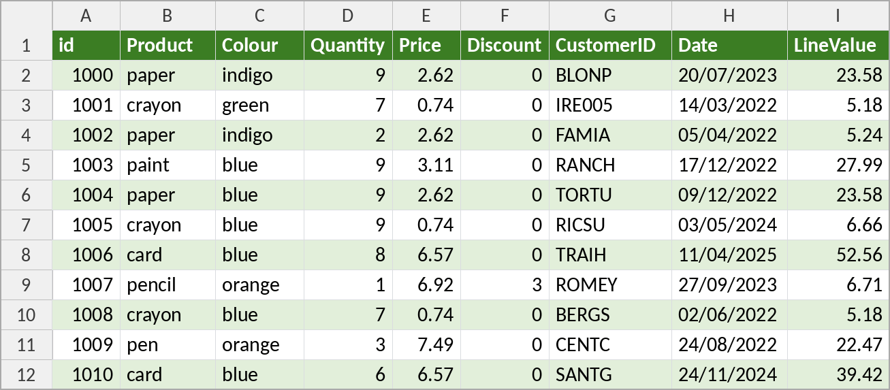

- **Data types:** the icon on each column heading in the editor shows its type: 📅 date, *123* whole number, *1.2* decimal. Making sure dates really are dates means you can sort them oldest to newest and group by month.
- **Calculated column:** the source system stores quantity, price and discount but not the line total. A **custom column** (Add Column > Custom Column) works it out on the way in. AI wrote the formula. The syntax is a little different from Excel, but the idea is the same.

The full query as stored in the workbook (Power Query's "M" language):

```powerquery
let
    Source = Json.Document(Web.Contents("https://api.acodingtutor.com/sales_records")),
    #"Converted to Table" = Table.FromList(Source, Splitter.SplitByNothing(), null, null, ExtraValues.Error),
    #"Expanded Column1" = Table.ExpandRecordColumn(#"Converted to Table", "Column1",
        {"id", "Product", "Colour", "Quantity", "Price", "Discount", "CustomerID", "Date"},
        {"id", "Product", "Colour", "Quantity", "Price", "Discount", "CustomerID", "Date"}),
    #"Changed Type" = Table.TransformColumnTypes(#"Expanded Column1",
        {{"Date", type date}, {"Discount", Int64.Type}, {"Price", type number}, {"Quantity", Int64.Type}}),
    #"Added Custom" = Table.AddColumn(#"Changed Type", "LineValue",
        each Number.Round([Quantity] * [Price] * (1 - ([Discount] / 100)), 2))
in
    #"Added Custom"
```

### 8.4 Data-driven reports
**Tab: Calculations.** The summary formulas point at the query's table, so **Refresh All** brings in new data and every figure recalculates. You don't need to change any ranges.

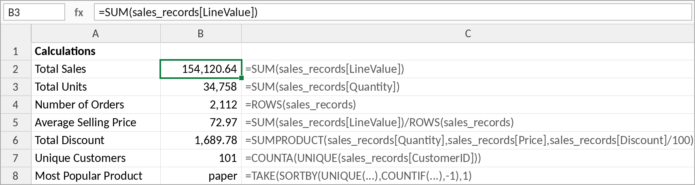

| Measure | Formula |
|---|---|
| Total Sales | `=SUM(sales_records[LineValue])` |
| Total Units | `=SUM(sales_records[Quantity])` |
| Number of Orders | `=ROWS(sales_records)` |
| Average Selling Price | `=SUM(sales_records[LineValue])/ROWS(sales_records)` |
| Total Discount | `=SUMPRODUCT(sales_records[Quantity],sales_records[Price],sales_records[Discount]/100)` |
| Unique Customers | `=COUNTA(UNIQUE(sales_records[CustomerID]))` |
| Most Popular Product | `=TAKE(SORTBY(UNIQUE(sales_records[Product]),COUNTIF(sales_records[Product],UNIQUE(sales_records[Product])),-1),1)` |

**Live demo:** a new customer (*Aidan's Fourth Company*) was added on the website. After **Refresh**, `=ROWS(Customers)` went from 110 to 111 without any change to the formulas.

**Real-world examples (a credit union)**
- Month-end reporting from six systems went from **1.5–2 days to under half a day** using Power Query connections.
- A branch-closing task went from **15 minutes to 5**: open the file, hit Refresh, save. Across 6 branches, 5 days a week, that saves **about 5 hours every week**.

---

## 9. Bank reconciliation
**Tabs: Invoices and Bank Transactions**

> **Ask for the method, not the answer.** You *could* paste both lists into AI and ask it to reconcile them, but then you'd have to check its answer by hand. Ask for **formulas** instead. You can check a method by changing the data and watching the result.

**Step 0:** convert both lists to tables (**Ctrl+T**) and name them `Invoices` and `BankTransactions`.

### 9.1 Extract the invoice number from the description
The reference can be at the start, in the middle or at the end of the description (*"INV1003 BlueSky Co"*, *"Payment Delta INV1005 part"*, *"REF:INV1006 Nova Ltd"*).

```text
I have a table called BankTransactions. It has a column Description which contains
transaction details and may include an invoice number as a reference.
Invoice numbers are in the format INVxxxx, where xxxx is a number of digits, for example:
  Payment ABC Ltd INV1001
  INV1003 BlueSky Co
  Apex Solutions invoice INV1004
Can you give me a formula to extract the invoice number into its own column?
```

**This took several attempts.** The first answers (built from FIND, MID and LET) got tripped up by the word *"invoice"*, because it contains "inv". Rather than fixing the formula ourselves, we nudged the AI: *"Isn't there a pattern-matching technique you can use?"* That got us a **regular expression**:

```excel
=IFERROR(REGEXEXTRACT([@Description],"INV\d+"),"")
```
`INV\d+` means *"INV followed by one or more digits"*. If there's no match, the cell is left blank instead of showing an error.

⚠️ The REGEX functions (`REGEXEXTRACT`, `REGEXTEST`, `REGEXREPLACE`) are new (2024–25). You need an up-to-date Microsoft 365.

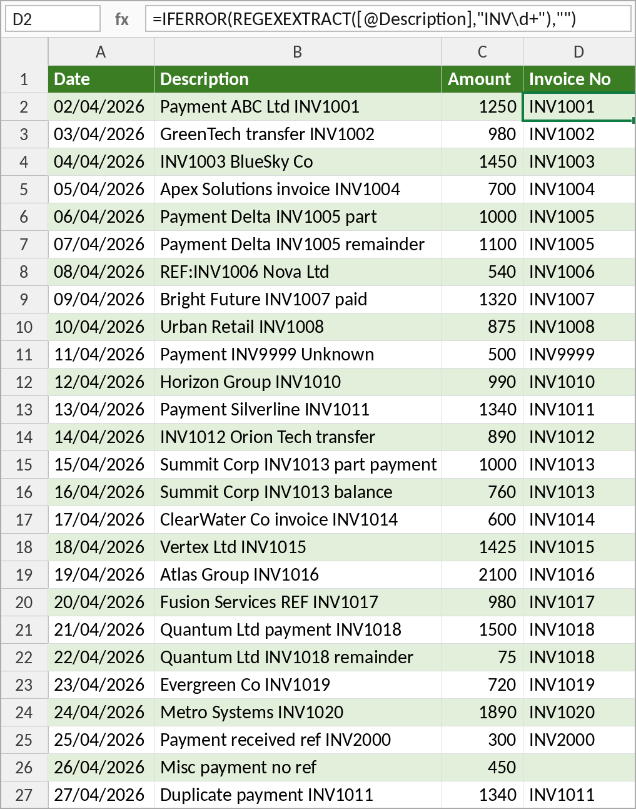

### 9.2 Which invoices have no payment?
```text
I need to do a reconciliation. There is a table called Invoices with a column Invoice No.
There is a table called BankTransactions with a column Invoice No.
Can you give me a formula that will return the list of invoices that have no transaction?
```
```excel
=FILTER(Invoices[Invoice No],
        COUNTIF(BankTransactions[Invoice No],Invoices[Invoice No])=0,
        "All invoices matched")
```
Result: **INV1009**.

FILTER with COUNTIF has largely replaced VLOOKUP for comparing two lists, and it's fast even with tens of thousands of rows.

**Testing it:** change an invoice reference in the bank data and that invoice appears in the list. Add a payment for INV1009 and it disappears. ✔

### 9.3 Full reconciliation: not paid, underpaid, overpaid, paid in full
Some invoices are paid in two parts (INV1005, INV1013, INV1018), and some are paid twice (INV1011).

```text
Each invoice has an Amount column. Each bank transaction has an Amount column.
Can you give me a reconciliation that will show each invoice with the following status:
Not paid, Underpaid, Overpaid, Paid in full.
```

Add these columns to the **Invoices** table:

```excel
Amount Paid:  =SUMIFS(BankTransactions[Amount],BankTransactions[Invoice No],[@[Invoice No]])

Difference:   =[@Amount]-[@[Amount Paid]]

Status:       =LET(paid, SUMIFS(BankTransactions[Amount],BankTransactions[Invoice No],[@[Invoice No]]),
                   amt,  [@Amount],
                   IF(paid=0,"Not paid",
                   IF(paid<amt,"Underpaid",
                   IF(paid>amt,"Overpaid","Paid in full"))))
```

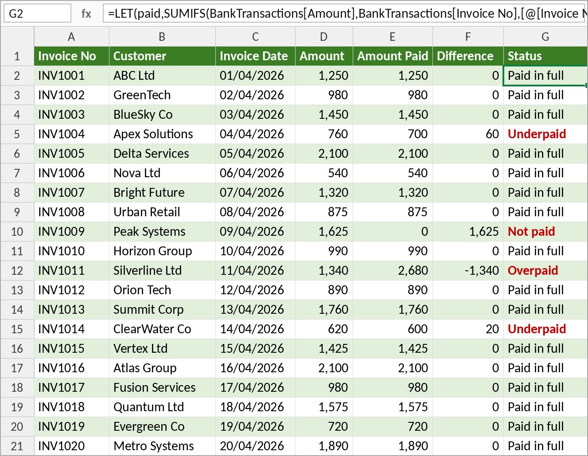

| Invoice | Amount | Paid | Status |
|---|---|---|---|
| INV1004 Apex Solutions | 760 | 700 | Underpaid by 60 |
| INV1009 Peak Systems | 1,625 | 0 | Not paid |
| INV1011 Silverline Ltd | 1,340 | 2,680 | Overpaid (paid twice) |
| INV1014 ClearWater Co | 620 | 600 | Underpaid by 20 |

The other way round, three bank lines match no invoice: **INV9999**, **INV2000** and *"Misc payment no ref"*.

**What went wrong in class, and how to handle it**
- It took six rounds to get a working Status formula. Copilot was slow that day, and the answers were poorer than usual.
- Some of the errors were ours: a typo in a table name and a column name with a space (*Invoice No*). Check that the names in your prompt **exactly** match the names in the workbook.
- When a pasted formula fails, Excel highlights where it found the first problem. Start looking there.
- If a tool is struggling: **switch tools**, **start a new chat** (long conversations drift), or **come back later**.

---

## 10. Copilot inside Excel (paid licence)
With a paid Microsoft 365 Copilot licence, a **Copilot** button opens a side panel inside Excel. Since spring 2026 it can **edit the workbook directly** ("let's edit your work"). You give the instructions from the sidelines and it does the work.

We used it on a fresh copy of the data file:

| Prompt | Result |
|---|---|
| *Can you put a formula into G2 to calculate the compound interest?* | It asked whether we wanted the final balance or the interest, then wrote the formula. There was no need to describe the cells |
| *Can you put checkboxes into column B and make it so that when a checkbox is ticked the corresponding item in column A is crossed out?* | It added the checkboxes and the conditional formatting rule |
| *Can you put a lookup into G2 that will show the product name and price for the product in F2? Can you turn F2 into a drop-down?* | XLOOKUP returning **two columns**, plus data validation |

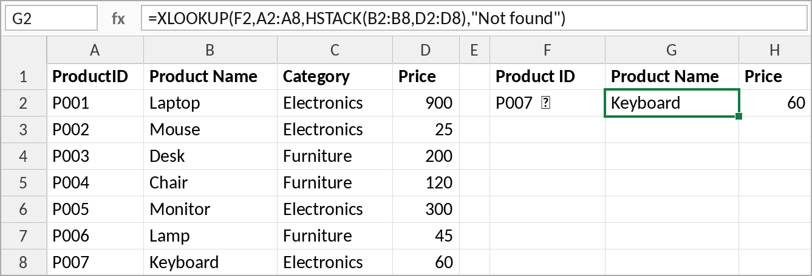

```excel
=XLOOKUP(F2,A2:A8,HSTACK(B2:B8,D2:D8),"Not found")
```

**Is it worth it?**
- Cost: roughly **€30 → €70 per user per month**. That's easier to justify for a small team than for a thousand people.
- Speed: three exercises that took around 40 minutes by hand took **about 4 minutes**.
- Risk: when AI does all the work, it's tempting to **stop checking**. Keep checking.

---

## 11. Can AI audit a spreadsheet?
We uploaded **AiAndExcel_Errors.xlsx** to ChatGPT:

```text
I'm working with Excel. I was given a spreadsheet that has some errors.
Can you identify the errors, explain what's wrong and how to fix them?
```

It found the planted errors and a few others:

| Sheet | Error in the file | Fix |
|---|---|---|
| **Error1** | The conditional format rule should highlight the row with the highest value, but `=$D2=MAX($D$2:$D$11)` only looks at **January** | `=MAX($D2:$O2)=MAX($D$2:$O$11)` |
| **Error2** | Q3 is `=SUM(Sales[May], Sales[Jun], Sales[Jul])`, the wrong months | `=SUM(Sales[Jul], Sales[Aug], Sales[Sep])` |
| **Error3** | The bonus logic `=D2+IF(AND(F2>G2, H2=TRUE), E2, 0)` is fine, but the **old form-control checkboxes** are linked to the wrong cells: 17 controls on 10 rows, and several of them linked to `$H$2` | Replace them with native checkboxes (Insert > Checkbox) |
| **Error4** | `=SUBTOTAL(9, Expenses[Amount])` vs `=SUM(Expenses[Amount])`: they agree until the table is filtered, because SUBTOTAL ignores hidden rows | Choose the one you actually mean and label it |
| **Error5** | `=F2*(1+N2)` copied down becomes `=F3*(1+N3)`, so only row 2 gets VAT | Anchor the VAT cell: `=F2*(1+$N$2)` |
| **Error5** | The average `=SUM(J2:J12)/COUNT(J2:J11)` includes the **total** in J12 | `=AVERAGE(J2:J11)` |
| **Error5** | Data problems: missing quantity (order 1009), zero quantity (1003), invalid date *33/01/2026* (1008), unknown customer C999, Desk Lamp priced 1.50 in one row and 18.00 in another | Fix at source, or validate as the data comes in |

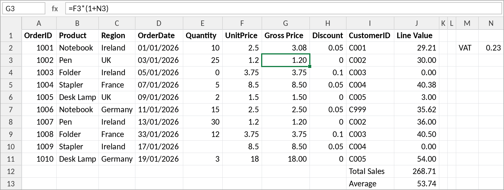

> AI makes a good **first pass** at checking a spreadsheet, but it won't always find every error. A professional review is still needed.

---

## 12. Summary

**What we got AI to do in Excel**
- Create, explain, debug and rewrite formulas, including LET, SEQUENCE, VSTACK, XLOOKUP, FILTER, SUMIFS and REGEXEXTRACT
- Build checklists with native checkboxes and conditional formatting
- Add XLOOKUP lookups and data-validation dropdowns
- Convert data to tables and use structured references
- Use Power Query from scratch: import, remove duplicates, replace values, set data types, add calculated columns, refresh
- Build data-driven reports that update when you refresh
- Reconcile invoices against bank transactions
- Work directly in the workbook through Copilot in Excel
- Audit an uploaded workbook for errors

**Habits to take away**
1. Give **context** and a **persona**, and ask for **step-by-step instructions**.
2. Always state the **exact cells, sheet, table and column names**. A screenshot is a quick way to do this.
3. Describe **what you want to achieve**, not which feature to use.
4. Ask for the **method (a formula)** rather than the answer, so you can check it.
5. Expect to **iterate**. If a tool struggles, switch tools or start a new chat.
6. **Verify everything.** AI is an able assistant, not an infallible oracle.

**Quick reference: useful shortcuts**

| Shortcut | Where | What it does |
|---|---|---|
| **Shift+Enter** | ChatGPT / Copilot prompt box | New line without sending (use it to separate the prompt from the data) |
| **Alt+Enter** | Excel formula bar | New line inside a formula |
| **Ctrl+T** | Excel | Convert a range to a table |
