<!-- toc -->

# AI in Excel Using ChatGPT & Copilot 

These notes follow the course in the order it is now delivered. The worked examples use the course files:

- **AI in Excel data.xlsx**, the main workbook (one tab per exercise)
- **AI in Excel errors.xlsx**, a workbook with deliberate mistakes, used in the last demo

Tools: **ChatGPT** (chatgpt.com in a browser) and **Microsoft Copilot** (the app that comes with Microsoft 365). You can do the whole course with either one, and everything except Section 11 works on the free versions. If ChatGPT is blocked at your workplace, use Copilot throughout.

> AI does not give the same answer every time. If you type the prompts below you may get a slightly different formula from the one shown. That is normal. Test whatever you get.

---

## 1. Understanding AI before you use it

### Why now?
AI has been around for decades, but until ChatGPT arrived in late 2022 you needed a PhD, a supercomputer and a team to use it. What changed is that anyone can now **talk to the computer as if it were a human**, in ordinary English, typos and all. Ask *"What is the capital of Azerbijan?"* with the name misspelt and you still get the right answer. A traditional search engine would only find pages with your exact spelling. AI works out what you meant.

You don't need to understand the technology to use it, any more than you need to understand the national grid to flick a light switch. But a few basics help.

### Where the answers come from
Every AI system is trained on a huge body of text, called the **corpus** or training data, and most of it comes from the internet. The internet has no editor in charge. Some of that material is excellent, some is doubtful and some is simply wrong. A second component, **natural language processing (NLP)**, lets the AI understand and write ordinary English. Big improvements in NLP over the last 5–10 years are what triggered the current boom. Put the two together and you get a **large language model (LLM)**, which is what ChatGPT, Copilot and Grok are.

### Six things to keep in mind

| Limitation | What it means | Example |
|---|---|---|
| **It can be wrong** | Both tools say so on screen: *"AI-generated content may be incorrect"* / *"ChatGPT can make mistakes"* | Different counts for the number of countries in Europe |
| **It is not deterministic** | The same question can give a different answer on a different day. Accountants are used to systems where the same input always gives the same output; AI isn't one | Anywhere from 39 to 53 countries in Europe, depending on the day |
| **Sources aren't clear** | You often can't tell where an answer came from | Copilot sometimes cites a website. ChatGPT often cites nothing |
| **Out of date** | The training data can lag behind the real world | Ireland's population (answers of 5.4m vs the CSO's ~5.56m, and occasionally as far out of date as 4.7m); Bulgaria's currency (it has used the euro since 1 Jan 2026) |
| **Bias** | The source material may be one-sided, and AI treats all information as equal | Different AIs lean in different political directions; Grok openly so |
| **Hallucination** | It may invent plausible-looking facts | A list of Cork Tesco stores, with Eircodes, that included stores (and Eircodes) that don't exist |

### It tells you what it thinks you want to hear
An AI's job is to give you an answer it thinks you'll be happy with. That makes it a bit of a people-pleasing "yes-man", which isn't the ideal source for critical business decisions. Hallucination is the extreme case: rather than admit it doesn't know, or look something up, it makes something up.

### Busy days are bad days
When the service is busy (usually in the afternoon, once the US is online), answers get slower, shorter and less reliable. The AI may cut corners: in the Tesco example it first claimed 150 records was *"too large for a single chat response"*, which is nonsense for a computer. You can check OpenAI's status at **status.openai.com**. Microsoft doesn't publish an equivalent page for Copilot.

> **Key principle:** treat AI as a capable assistant, not an infallible oracle. Check everything it gives you. In Excel that's easy, because you can see the formula and test it.

### Get help *with* the analysis, not the analysis itself
You could upload your data and ask AI for the answer. But if it says *"the answer is 27"*, you still have to verify that 27 is right, which means doing the analysis anyway. In practice it works better to ask AI **how** to do the analysis (a formula, a method, step-by-step instructions). You can see the method, test it and reuse it. This idea comes up all through the course.

**Tips**
- Try a "test question" in two different AIs and compare the answers.
- Ask for populations or currencies to get a rough idea of how current the information is.
- If one tool is having a bad day, switch to the other, start a **new chat**, or try again later.

---

## 2. The parts of a prompt

The more of these parts you include, the better and more consistent the answers tend to be.

| Part | Question it answers | Example |
|---|---|---|
| **Context** | Who are you and what are you trying to do? | *I'm working with Excel.* / *I'm an accountant.* |
| **Persona** | Who should the AI be? | *Act as an Excel expert.* |
| **Request** | What do you want? Be clear, unambiguous and concise | *Give me a formula to calculate compound interest.* |
| **Examples** | What does a good answer look like? | *…for example INV1001* |
| **Constraints** | What are the limits, or what don't you want? | *Under 150 words.* / *No VBA.* / *Only countries with over 100,000 people.* |
| **Technique / method** | How should it be done? | **"Give me step-by-step instructions"**, the most useful phrase for Excel work |
| **Data** | What should it work on? | Pasted values, a screenshot or an uploaded file (use the **+** button) |
| **Delimiter** | Where does the prompt end and the data begin? | Press **Shift+Enter** to start a new line without sending the prompt |
| **Tone** | How should it sound? | *Plain English, for a non-technical audience.* |
| **Format** | How should the answer be laid out? | Numbered list, table, bullet points, CSV |

**Context changes the answer.** *"I'm a psychologist. What does NLP stand for?"* gets **Neuro-Linguistic Programming**. *"I'm a computer programmer…"* gets **Natural Language Processing**. One line of context completely changed the answer. You don't have to tell it the truth, either: *"I'm the CEO of a multinational"* and *"I run a small local crèche"* will get you differently pitched answers to the same question.

**Persona sets the voice.** *"Act as a financial controller"*, *"…a solicitor who advises small businesses"*, *"…an Excel expert"*. (Try *"…a petulant teenager who avoids giving a straight answer"* if you want to see how far it goes.)

**Ambiguity causes inconsistency.** Part of the reason the "countries in Europe" count keeps changing is that *Europe* is open to interpretation: just the EU? Including the UK, Iceland and Switzerland? Russia and the other transcontinental countries? The Vatican and the microstates? The Eurovision entrants? Say exactly what you mean, add a constraint, and you get a much more repeatable answer.

**One instruction per line.** Use **Shift+Enter** to put each instruction on its own line. Three instructions stacked one under the other usually get a better answer than the same three run together in a paragraph.

"Prompt engineering" is really just good human communication: who you are, who you need, a clear and concise request, examples, limits (*my budget is €10–15k, not €50k+*), and not mixing up the instruction and the data. Mix them up and you get the AI equivalent of a birthday cake iced with *"Happy Birthday Adam with Blue Flowers"*.

> Because AI isn't deterministic, nobody can guarantee these techniques will fix every problem. In practice, using some or all of them, where appropriate, makes a noticeable difference.

### Start a new chat for each new topic
The AI remembers everything said earlier in a conversation and builds up a picture of you. That's useful within a task but gets in the way across tasks. Two examples:

- After asking for a formula *"without using the LET function"*, every later answer in that chat would avoid LET.
- Asking *"What is Power Query?"* in the chat used for the bank reconciliation produced an answer framed entirely around reconciliations.

So: **one topic, one chat.** Don't keep a single chat open from Monday to Friday. Each time you start a new chat, restate your context and persona (*"I'm working with Excel. I want you to be an Excel expert."*).

### Suggested exercise: an infographic of the parts of a prompt
Put the parts of a prompt to work, and end up with a handy reference sheet. Start a **new chat** and ask AI to design an infographic. The prompt below uses the parts of a prompt itself; see how many you can spot.

```text
I'm a trainer running a course on using AI at work.
Act as a graphic designer who specialises in clear, friendly infographics.
Create an engaging infographic of the "Parts of a Prompt".
The parts are: Context, Persona, Request, Examples, Constraints, Technique/Method,
Data, Delimiter, Tone and Format.
For each part, give a short description and an icon.
Make the point that prompt engineering is really just good human communication.
Don't use technical jargon.
Use a bright, friendly and encouraging style, in portrait layout.
```

Both ChatGPT and Copilot can create images, though free versions limit how many you can make per day.

**Sample results.** The same request produced quite different designs on different attempts. The first lists all ten parts as numbered cards and finishes with a worked example prompt that uses every part. The second stacks the parts like building blocks and sums up with *"good prompts aren't magic… they're just good communication skills"*.

| Result 1 | Result 2 |
|---|---|
| 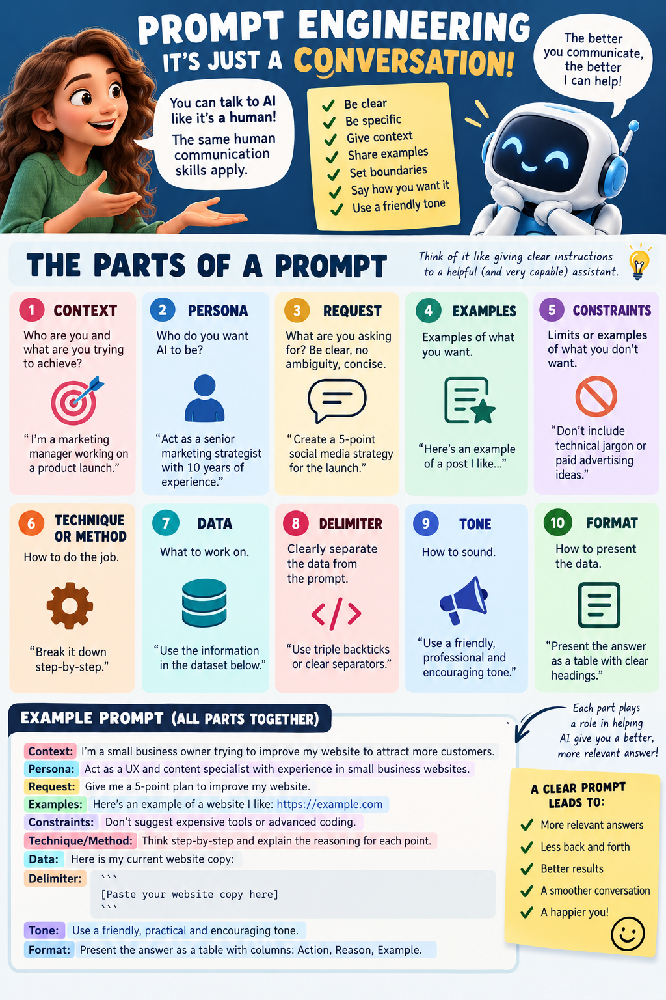 | 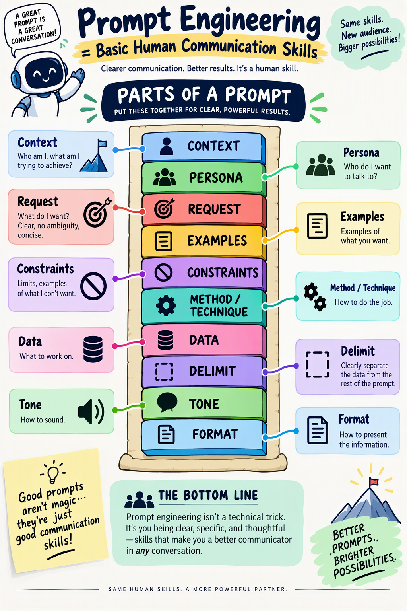 |

**Things to discuss**
- **Same request, different results.** This is non-determinism again (Section 1). If you don't like the first attempt, ask again or ask for changes (*"use our company colours"*, *"make it landscape"*).
- **Check the output, including the text.** AI images can contain misspelt words, garbled labels or a missing part. Check that all ten parts are there and correctly described before you share it.
- **Different answers can both be right.** Result 1 suggests triple backticks (` ``` `) as a delimiter; in this course we mostly use new lines (**Shift+Enter**). Both do the same job: clearly separating the data from the instructions.

---

## 3. Keeping your data safe

Every time you paste data, take a screenshot or upload a file, you are giving that information to the AI. Before you do, ask yourself whether it's sensitive.

**With the free versions of ChatGPT or Copilot**, don't share anything that is:
- business-critical or confidential
- personal or personally identifiable
- covered by GDPR

**You can usually get the formula without sharing the data:**
- Share the **structure**, not the contents: *"Column A is Product ID, column B is Product Name, column D is Price."*
- Screenshot just the **header row** and perhaps one row of data.
- Replace real values with **made-up ones** before you take the screenshot or paste.
- Share a **small subset** rather than the whole file.

**With a paid Microsoft 365 Copilot licence**, use **Add content** to point Copilot at a file in your **OneDrive**, rather than uploading a copy. The file stays within your organisation's Microsoft 365 environment.

> Check your organisation's AI policy. Many organisations block ChatGPT and approve Copilot only, and some have rules about what can be shared with either.

---

## 4. Formulas with AI

### 4.1 Create a formula: compound interest
**Tab: Compound Interest**

The prompt (note how precise the cell references are):

```text
I'm working with Excel.
I want you to be an Excel expert.
I need a formula for compound interest.
B2 contains the principal, C2 contains the rate, D2 contains the term in months
and E2 contains the compounding interval (annually, quarterly, monthly or weekly).
Can you give me a formula I can put in G2?
```

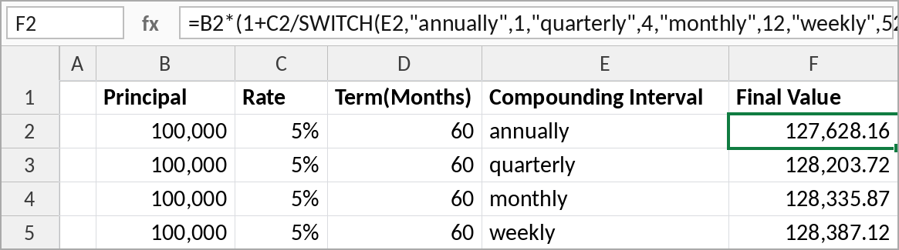

A typical answer (this returns the final value, i.e. principal plus interest):

```excel
=B2*(1+C2/SWITCH(E2,"annually",1,"quarterly",4,"monthly",12,"weekly",52))
   ^(SWITCH(E2,"annually",1,"quarterly",4,"monthly",12,"weekly",52)*D2/12)
```

For the **interest only**, subtract the principal: `=F2-B2`. The AI often offers both versions.

**Sanity checks we did**
- 5% of €100,000 is €5,000 a year. Over 5 years that's about €25,000 plus some compounding, so **€127,628** (i.e. €27,628 interest) for annual compounding is in the right ballpark.
- More frequent compounding should mean more interest (annually < quarterly < monthly < weekly). ✔
- You may get a different but equivalent formula. The prompt didn't say "final value" or "interest", so be specific.
- For more confidence, ask for a second method or put the same question to a different AI.

> **Tip:** always give the AI the exact cells, sheet name and table name. You get back a formula with your references already plugged in, ready to paste, instead of a formula from a website that you then have to adapt.

### 4.2 Explain a formula
You've been given a spreadsheet with no documentation and a formula you don't understand. Paste it in and ask:

```text
Can you tell me what the following formula does?
=LET(a,range1,b,range2,countA,ROWS(a),countB,ROWS(b),seq,SEQUENCE(countA+countB),
     IF(seq<=countA,INDEX(a,seq),INDEX(b,seq-countA)))
```
*(the "combine ranges" example from exceljet.net, an excellent Excel reference site)*

The AI answered: *"This formula combines two vertical ranges into one continuous list, placing range 2 directly underneath range 1."* That was short, concise and correct. It then broke the formula down step by step and pointed out that a newer function, **VSTACK**, does the same job.

### 4.3 Debug a formula
We pasted the formula into a blank sheet and got `#NAME?`. The follow-up prompt:

```text
I've pasted this formula into cell F2 and I get #NAME?. What do I do?
```

The AI correctly spotted that `range1` and `range2` are placeholders that have to be replaced with real ranges, e.g. `A2:A7` and `C2:C5`. It may also ask which version of Excel you're using, because the VSTACK alternative needs Microsoft 365 or Excel 2024. Answer it: the version matters.

### 4.4 The LET function
If you haven't used **LET**, you're in good company: when asked *"Have you used the LET function?"*, around 80% of people on this course answer no. LET was added around 2019–2020. It lets you **name values or calculations inside a formula** and reuse them, breaking a complex calculation into steps.

> If your Excel knowledge dates from before about 2019, you're missing some major changes: LET, dynamic arrays, XLOOKUP and more. A refresher is worthwhile.

How it's built: pairs of *name, value*, followed by a final result.

```excel
=LET(a, 10,
     b, 20,
     a + b)
```

> **Tip:** press **Alt+Enter** inside the formula bar to put each step on its own line. You can also drag the formula bar to make it taller. While building, make the last line any one of your names to check that step's value.

We rebuilt the combine-ranges formula one step at a time:

```excel
=LET(a,    A2:A7,                    step 1: first range
     b,    C2:C5,                    step 2: second range
     lenA, ROWS(a),                  step 3: 6 rows
     lenB, ROWS(b),                  step 4: 4 rows
     s,    SEQUENCE(lenA+lenB),      step 5: 1..10 (a dynamic array that spills)
     IF(s<=lenA, INDEX(a,s), INDEX(b,s-lenA)))
```

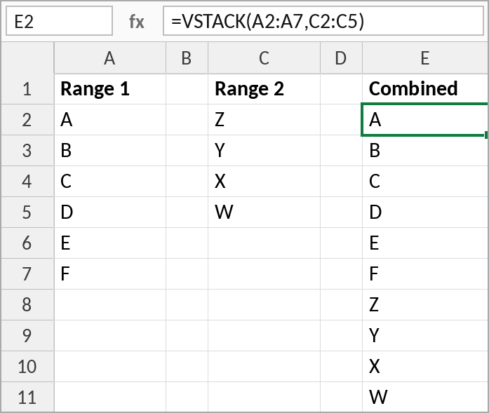

**Dynamic arrays.** SEQUENCE is a *dynamic array* function: one formula in one cell **spills** results into the cells around it. If something is in the way you get `#SPILL!`. Clear the blocking cells.

**Why LET matters.** We asked: *"Can you rewrite this formula without using the LET function?"* The rewritten version calls `ROWS(A2:A7)` five times, `ROWS(C2:C5)` three times and `SEQUENCE` three times. On 10,000 rows that repetition can slow a workbook down. LET calculates each value once. Usually you'd go the other way: ask AI to *simplify* a formula and it will often restructure it with LET.

Even if you never write LET yourself, **learn to recognise it**. AI answers use it a lot, and you can't check what you can't read.

**The modern replacement.** The AI's own recommendation:

```excel
=VSTACK(A2:A7,C2:C5)
```

**What AI did with formulas:** created one, explained one, debugged one, explained a function inside one, rewrote one in an older style, and suggested a modern replacement.

---

## 5. A to-do list with checkboxes
**Tab: ToDo**

The prompt is plain English and doesn't mention any Excel feature by name:

```text
I have a sheet called ToDo. Column A1 to A10 contains to-do items.
Can you give me step-by-step instructions to add checkboxes to B1 to B10
and cross out the text in the corresponding cell in column A if the checkbox is checked.
```

| Before | After |
|---|---|
| 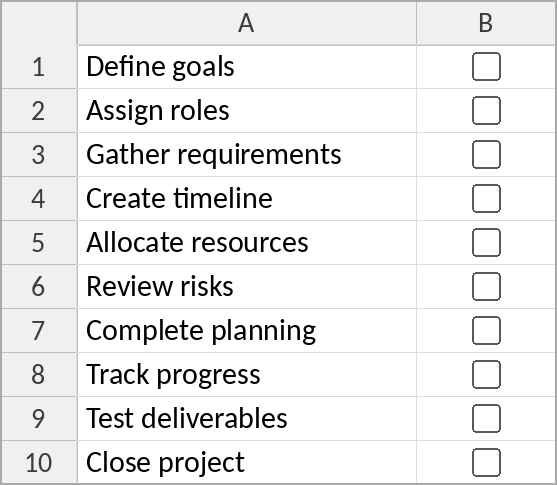 | 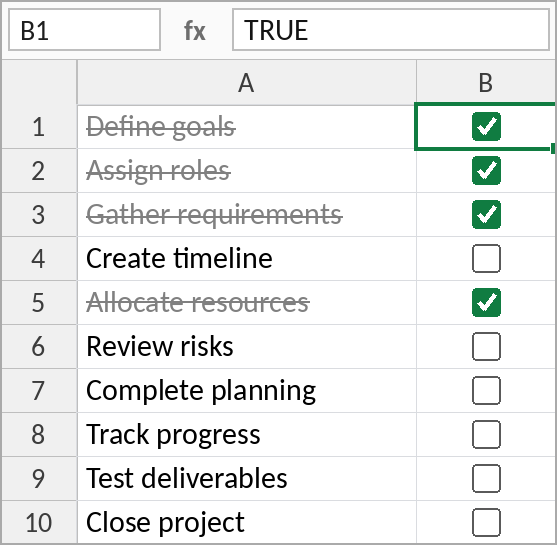 |

**Steps (as the AI gave them)**
1. Select **B1:B10** and choose **Insert > Checkbox**.
2. Select **A1:A10**, then go to **Home > Conditional Formatting > New Rule > Use a formula to determine which cells to format**.
3. Enter the formula:
   ```excel
   =$B1=TRUE
   ```
4. Click **Format… > Font** tab, tick **Strikethrough** (and optionally choose a grey colour), then click **OK** and **OK** again.

**About the new checkboxes**
- These are **native in-cell checkboxes**. They arrived quietly in Microsoft 365 around mid-2025. The cell's value is just **TRUE** or **FALSE**.
- Because they're just data, they are **auditable**. The old-style checkboxes were error-prone and auditors tended to treat them with suspicion.
- You can copy them, fill them down, and they extend automatically in a table.
- ⚠️ If the AI tells you to use **Developer > Insert > Form Control > Check Box**, that answer is **out of date**. Reply *"Isn't there a more modern way of doing this?"* Those older checkboxes have to be linked to a cell one at a time, and they're easy to get wrong (see Error 3 in Section 12).

### Extension: list what's left to do
```text
Can you give me a formula that will show the items that are remaining?
I want to put this in cell E2.
```
A typical answer:
```excel
=FILTER(A1:A10,B1:B10=FALSE,"All done!")
```
The list shrinks as you tick items off, and shows a friendly message when everything is done.

> **Key lesson:** describe the *result* you want. You don't need to know the name of the feature (conditional formatting, here). And if you use a feature only every few months, AI saves you having to remember the steps.

---

## 6. XLOOKUP and dropdown lists
**Tab: XLOOKUP**

> **Tip:** you don't have to describe your data. **Take a screenshot** (e.g. with Snipping Tool) and paste it into the prompt. AI is very good at reading images. This works for almost any computer problem: screenshot it, say which application you're in, and ask what to do. (Mind what's in the screenshot: see Section 3.)

```text
I have a sheet with the attached data [screenshot].
Can you give me a formula that will look up the product name for the product ID in cell F2?
```

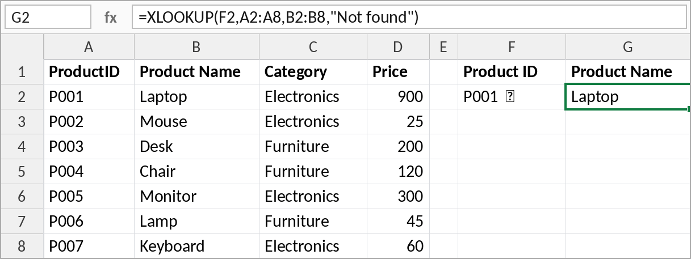

```excel
=XLOOKUP(F2,A2:A8,B2:B8,"Not found")
```

Testing it: P001 → Laptop, P007 → Keyboard, P004 → Chair, P999 → *Not found*. ✔

**XLOOKUP vs VLOOKUP**

| | VLOOKUP | XLOOKUP |
|---|---|---|
| Not-found message | Needs wrapping in `IFNA`/`IFERROR` | Built in (4th argument) |
| Look-up column | Must be the first column | Any column, including to the left |
| Default match | Approximate (risky) | **Exact** (safer) |
| Columns returned | One | One or several |

If you still use VLOOKUP, AI will usually give you XLOOKUP instead. That's a good opportunity to update your habits. You can also paste in an existing VLOOKUP and ask: *"Can you rewrite this as an XLOOKUP?"*

### Return more than one column
```text
Can you give me a modified formula to return both the product name and the price?
```
```excel
=XLOOKUP(F2,A2:A8,CHOOSECOLS(B2:D8,1,3),"Not found")
```
CHOOSECOLS picks columns 1 and 3 of B:D (name and price), and the result spills into two cells. You may instead get a version using HSTACK (see Section 11). Both work.

### Turn F2 into a dropdown
```text
Can you give me step-by-step instructions to convert cell F2 into a drop down?
```
1. Select **F2** and go to **Data > Data Validation** (in the *Data Tools* group; the icon has a tick and a no-entry sign, and may show without a label on a narrow screen).
2. Set **Allow** to **List**.
3. Set **Source** to `=$A$2:$A$8`.
4. Make sure **In-cell dropdown** is ticked, then click **OK**.

Users can now only choose a valid product ID. Typing anything else brings up an error.

---

## 7. Exercise: progress tracker
**Tab: Progress**

**Task:** put a checkbox under each stage (Plan, Approve, Execute, Review, Complete) for each job, and get AI to give you a formula for the percentage complete.

```text
I have five checkboxes in cells B2 to F2. Can you give me a formula that will calculate
a percentage complete for these checkboxes? If one box is ticked that would be 20%,
if all five boxes are checked it would be 100%.
```

```excel
=COUNTIF(B2:F2,TRUE)/COLUMNS(B2:F2)
```
Format it as a percentage, then fill the checkboxes and the formula down.

**Extension: make it visual.** Ask:
```text
I have a formula in G2 to G6 that calculates the percentage done of a task.
Can you tell me how to make this into a visual representation instead of the number?
```
There are several valid answers (data bars, a text bar, sparklines), and you may get any of them.

**Option A: data bars (conditional formatting)**
1. Select **G2:G6**, then **Home > Conditional Formatting > Data Bars** and pick a style.
2. ⚠️ The bars won't be right at first: by default Excel treats the *largest value in the range* as a full bar, so 60% can look complete. Fix it with **Home > Conditional Formatting > Manage Rules > Edit Rule**, and set **Minimum** to type **Number**, value **0**, and **Maximum** to type **Number**, value **1**.
3. Don't use type **Percent** here. In this dialog, "Percent" means a percentage of the range of values, not a fixed 0–100% scale.

**Option B: a text progress bar with REPT**, which repeats a character *n* times:

```excel
=REPT("█",ROUND(G2*10,0))&REPT("░",10-ROUND(G2*10,0))
```

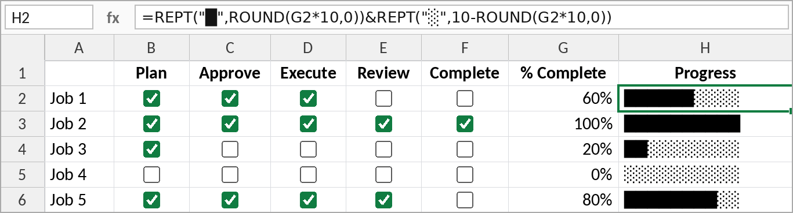

---

## 8. Excel Tables and structured references
**Tab: ProjectTasks**

This is a good point to switch to **Copilot** (new chat, context and persona again) to show it handles Excel just as well as ChatGPT.

```text
I have some data in a sheet called Project Tasks. Should I convert this to a table?
Can you tell me how to convert it to a table?
Can you tell me the features of a table?
```

**Create a table:** click anywhere in the data and press **Ctrl+T**. Check that the range is correct and that **My table has headers** is ticked, then click **OK**.

**Features**
- **Automatic expansion**: type in the row (or column) next to the table and the table grows. Formulas and checkboxes fill down automatically.
- **Filter and sort** buttons on every header.
- **Table Design tab**: a *contextual* tab that only appears when you click inside a table. Click outside and it disappears.
- **Styles**: choose one on the **Table Design** tab, or create a **new table style** in your company colours. Banded rows make long lists much easier to read.
- **Total row**: Sum, Count, Average, Max or Min (Table Design > Total Row).
- **Name your table.** Go to **Table Design > Table Name** and give it a meaningful name such as `ProjectTasks`. *Table1*, *Table2* and *Table3* are terrible names.
- **TRUE/FALSE columns**: anywhere you see TRUE/FALSE, turn it into checkboxes (Insert > Checkbox). New rows get the checkbox automatically.

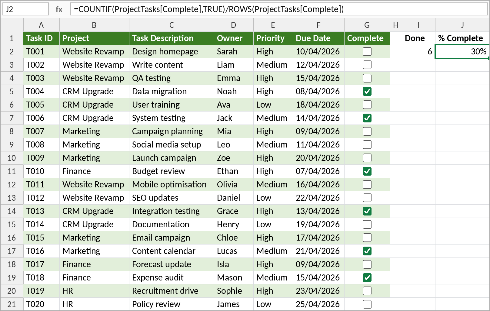

### Structured references
When asked *"Have you used structured references?"*, roughly 40–50% of people on this course answer no. These two formulas do exactly the same job:

```excel
=COUNTIF(G2:G21,TRUE)
=COUNTIF(ProjectTasks[Complete],TRUE)
```

The second one tells you exactly what it's counting: the *Complete* column of the *ProjectTasks* table. It **never needs to change** as rows are added. A traditional `G2:G21` reference has to be rewritten every time (Excel does this for you, but it's still a change to the formula).

The difference is even clearer on another sheet, such as a dashboard:

```excel
=COUNTIF('Project Tasks'!G2:G24,TRUE)     needs the sheet name, and changes as rows are added
=COUNTIF(ProjectTasks[Complete],TRUE)     identical on every sheet, never changes
```

**Typing them:** start typing the table name and IntelliSense offers it (with a small table icon). Type `[` and it lists the table's columns to pick from.

> **Don't know what something is called? Ask.** We asked: *"This formula uses ProjectTasks[Complete]. It's a reference I don't recognise. What is this called, and how does it work?"* The answer: a **structured reference**. Once you know the name of a feature, you can find out everything else about it.

The percentage complete formula the AI gave us:

```excel
=COUNTIF(ProjectTasks[Complete],TRUE)/ROWS(ProjectTasks[Complete])
```

We checked it: ticking every box gives 100%, and adding a new row (T023) drops it to 96%.

> If you're working with a table, AI will almost always give you structured references, so it's worth getting comfortable with them.

---

## 9. Bank reconciliation
**Tabs: Invoices and Bank Transactions**

> **Ask for the method, not the answer.** You *could* paste both lists into AI and ask it to reconcile them, but then you'd have to check its answer by hand. Ask for **formulas** instead. You can check a method by changing the data and watching the result.

### 9.1 Extract the invoice number from the description
The reference can be at the start, in the middle or at the end of the description (*"INV1003 BlueSky Co"*, *"Payment Delta INV1005 part"*, *"REF:INV1006 Nova Ltd"*). A screenshot of the data makes the prompt quick:

```text
I have the following data [screenshot].
I need to extract the invoice number from the Description column.
Invoice numbers are in the format INVxxxx, where xxxx is a number of digits.
Can you give me a formula that will reliably do this?
```
The word **reliably** is deliberate: it pushes the AI to think about awkward cases.

**This took several attempts.** The first answers (built from FIND, MID and LET) got tripped up by the word *"invoice"*, because it contains "inv". Three techniques got us to a good answer:

1. **Show it what happened.** Paste a screenshot of the results and name the failing rows: *"I tried the first formula and this is what I got. Lines 5 and 17 have the word 'invoice'."*
2. **Don't fix it yourself.** Even if you can see the problem, let the AI work it out. You learn more about what it can do.
3. **Nudge, don't tell.** *"I'm using Microsoft 365. Isn't there a better way to match a pattern?"* deliberately didn't name the answer. It got us a **regular expression**:

```excel
=IFERROR(REGEXEXTRACT([@Description],"INV\d+"),"")
```
`INV\d+` means *"INV followed by one or more digits"* (`\d` stands for a digit). If there's no match, the cell is left blank instead of showing an error.

⚠️ The REGEX functions (`REGEXEXTRACT`, `REGEXTEST`, `REGEXREPLACE`) are new (2024–25). You need an up-to-date Microsoft 365.

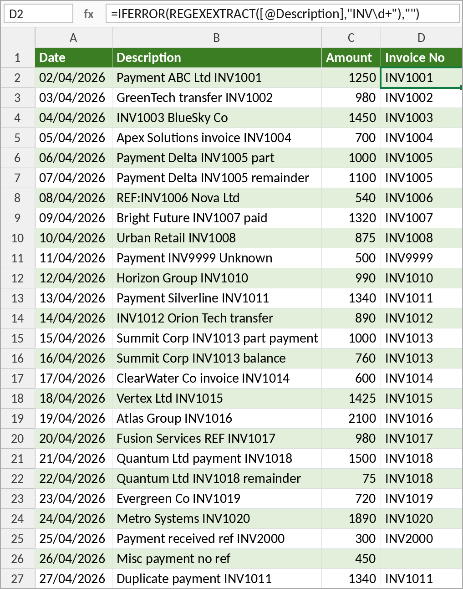

### 9.2 How do you know a formula is right on 10,000 rows?
This is one of the most common questions on the course, and it's the right one to ask. You can't check every row by eye, so build a **representative test set**:

- **Sample**: the first 100 rows, every 10th row, or a random selection.
- **Group by pattern**: e.g. reference at the start, in the middle, at the end, and "everything else". Check some of each.
- **Try to break it**: add rows with awkward data (extra spaces, ampersands, asterisks, two references, none at all) and see what happens.
- **Change the data and watch the result change**, then change it back.

When the test set passes, run the formula on the full data. For a second opinion, you can also upload the workbook to AI and ask it to check (see Section 12, and Section 3 first).

### 9.3 Which invoices have no payment?
```text
I need to do a reconciliation. There is a table called Invoices with a column Invoice No.
There is a table called BankTransactions with a column Invoice No.
Can you give me a formula that will return the list of invoices that have no transaction?
```
```excel
=FILTER(Invoices[Invoice No],
        COUNTIF(BankTransactions[Invoice No],Invoices[Invoice No])=0,
        "All invoices matched")
```
Result: **INV1009**.

FILTER with COUNTIF has largely replaced VLOOKUP for comparing two lists, and it's fast even with tens of thousands of rows.

**Why the tables matter.** If you ask before converting the lists to tables, the AI's first attempt typically uses ordinary ranges (`A2:D21`). It may also assume the formula is going on a different sheet from the one you intended, which gives a nonsense result. Even once it works, a new invoice (e.g. INV1021) won't show up, because the range stopped at row 21. Converting both lists to tables (**Ctrl+T**) and naming them `Invoices` and `BankTransactions` fixed it for good: the structured references cover every row, however many there are. Tell the AI the **exact** table names you chose, and ask it to *"update the formula accordingly"*.

> If you see a number like **46114** where you expected a date, it's a date stored as a serial number. Format the column as a date.

**Testing it:** change an invoice reference in the bank data and that invoice appears in the list. Add a payment for INV1009 and it disappears. ✔

### 9.4 Full reconciliation: not paid, underpaid, overpaid, paid in full
Some invoices are paid in two parts (INV1005, INV1013, INV1018), and some are paid twice (INV1011).

```text
Each invoice has an Amount column. Each bank transaction has an Amount column.
Some invoices have more than one transaction.
Can you give me a reconciliation that will show each invoice with the following status:
Not paid, Underpaid, Overpaid, Paid in full.
```

Add these columns to the **Invoices** table (type a heading in the next column and the table expands to include it):

```excel
Amount Paid:  =SUMIFS(BankTransactions[Amount],BankTransactions[Invoice No],[@[Invoice No]])

Difference:   =[@Amount]-[@[Amount Paid]]

Status:       =LET(paid, SUMIFS(BankTransactions[Amount],BankTransactions[Invoice No],[@[Invoice No]]),
                   amt,  [@Amount],
                   IF(paid=0,"Not paid",
                   IF(paid<amt,"Underpaid",
                   IF(paid>amt,"Overpaid","Paid in full"))))
```

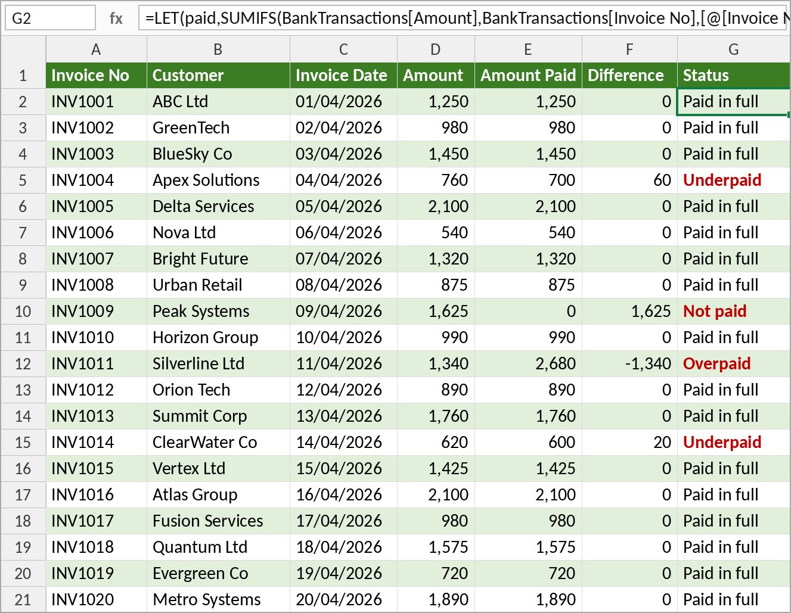

| Invoice | Amount | Paid | Status |
|---|---|---|---|
| INV1004 Apex Solutions | 760 | 700 | Underpaid by 60 |
| INV1009 Peak Systems | 1,625 | 0 | Not paid |
| INV1011 Silverline Ltd | 1,340 | 2,680 | Overpaid (paid twice) |
| INV1014 ClearWater Co | 620 | 600 | Underpaid by 20 |

The other way round, three bank lines match no invoice: **INV9999**, **INV2000** and *"Misc payment no ref"*.

**Common problems, and how to handle them**
- It can take several rounds to get a working Status formula, especially on a day when the tool is slow and the answers are poorer than usual.
- **Names must match exactly.** The AI may suggest a column name (e.g. *Total Paid*) that differs from the one you use (e.g. *Amount Paid*); its later formulas then need adjusting. Either use the AI's names, or tell it the names you used. Typos in table names and column names with spaces (*Invoice No*) catch people out too.
- **Put the formula where the AI expects it.** It's easy to paste a formula into the BankTransactions table when it was meant for Invoices. That's a human error, not an AI one.
- When a pasted formula fails, Excel highlights where it found the first problem. Start looking there.
- If a tool is struggling: **switch tools**, **start a new chat** (long conversations drift), or **come back later**.

---

## 10. Power Query
If you haven't used Power Query, you're in good company: when asked *"Are you familiar with Power Query?"*, around 80–90% of people on this course answer no, even though most are competent Excel users. When this course was first written (early 2023), the trainer hadn't used it either. The question was: *"Can AI take me from never having used an advanced feature to using it, with nothing but step-by-step instructions?"* The answer was yes. Everything the trainer knows about Power Query was learned this way, not from articles or videos.

Start a **new chat** for this (see Section 2), then:

```text
I'm working with Excel. I want you to be an Excel expert. What is Power Query?
```

**What Power Query is:** Excel's built-in data import, cleaning and transformation tool, often described as **ETL** (Extract, Transform, Load). It **connects** to data, **cleans** and **transforms** it (remove blanks and duplicates, fix dates, split and merge columns, replace values), **combines** related data sets, and lets you **refresh** it next week or next month. It has been part of Excel since about 2017; it's no longer a separate add-in. Many Excel professionals rate it the most important feature in Excel today.

**Sources include:** Excel and CSV files, text files, databases, websites and APIs, SharePoint, Power BI, even PDFs (useful for pulling figures out of an ERP system's PDF reports).

### 10.1 Import data from a website
The course website returns customer data in **JSON** format. It looks technical but is easy to read:
- `[ … ]` square brackets: a **list** (the whole table)
- `{ … }` curly brackets: one **record** (a row)
- `"column": "value"` pairs: the **columns** in that row

```text
Can you give me step-by-step instructions to get data from this URL:
https://api.acodingtutor.com/customers
The data looks like this: [paste two or three records]
```

1. **Data > Get Data > From Other Sources > From Web**, paste the URL, then **OK**. (The editor can take 5–10 seconds to open.)
2. In the Power Query Editor you'll see a *List*. Click **To Table** on the ribbon and accept the defaults.
3. Click the **expand** button (the two arrows in the *Column1* heading). Leave all the columns selected and **untick "Use original column name as prefix"** (otherwise every column is called *Column1.something*).
4. Check the data types, then go to **Home > Close & Load**.

> **The instructions won't always match your screen exactly.** For example, the AI may say *"ignore extra columns"* where the dialog offers *"truncate extra columns"*, or not mention the prefix tick box at all. Small differences like these are normal; use your judgement, and if you're stuck, screenshot the screen and ask.

Whatever the source, once you've connected the steps are the same.

**What you get**
- A **table**, named after the query (e.g. `Customers`), so structured references work: `=ROWS(Customers)`.
- The **Queries & Connections** pane (Data > Queries & Connections). Double-click a query (or right-click > Edit) to open the editor.
- **Refresh** fetches the latest data: right-click the table, or use the Refresh button on the **Table Design** or **Query** tab, or **Data > Refresh All**.

**Live demo:** a new customer was added on the website. After **Refresh**, the new row appeared in the table and `=ROWS(Customers)` went up by one, with no change to any formula.

### 10.2 Fix problems as the data comes in, not afterwards
**Duplicates.** We deleted a duplicate customer (IRE010) by hand, hit Refresh, and it **came back**. Ideally you'd fix the source system, but that isn't always possible. The prompt:

```text
I noticed that my data had a duplicate record. I deleted it from the table.
When I hit refresh it came back. How do I fix this permanently?
```
Open the query, select the **Customer ID** column, then **Home > Remove Rows > Remove Duplicates**, then **Close & Load**. The table went from 106 records to 105.

**Inconsistent values.** The country column contained both *Ireland* and *Republic of Ireland*, and both *USA* and *U.S.A.* (a "normalisation" problem: you want one name per country for reporting). Manual edits were lost on refresh again.

```text
I have values in my country column of Ireland and Republic of Ireland.
Can you tell me how to change them to Ireland? I tried changing them manually
but the changes are lost when I refresh.
```
In the editor, right-click a *Republic of Ireland* cell and choose **Replace Values** with *Ireland*. Do the same for *U.S.A.* → *USA*. Then **Close & Load**. When a new customer later arrives as *Republic of Ireland*, it comes in as *Ireland* automatically.

> **Rule:** never fix the data after it arrives. Get Power Query to fix it on the way in, so the fix is repeated on every refresh.

### 10.3 Data types and calculated columns
**Tab: sales_records**, already connected to `https://api.acodingtutor.com/sales_records` (2,112 rows).

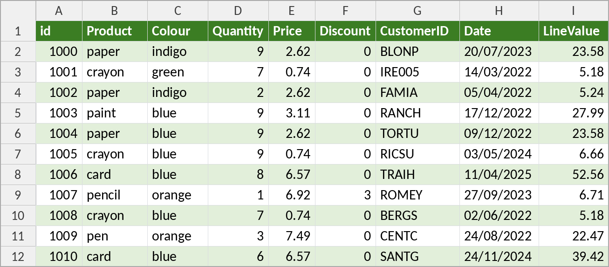

- **Data types:** the icon on each column heading in the editor shows its type: 📅 date, *123* whole number, *1.2* decimal. Making sure dates really are dates means you can sort them oldest to newest and group by month.
- **Calculated column:** the source system stores quantity, price and discount but not the line total. A **custom column** (Add Column > Custom Column) works it out on the way in. AI wrote the formula. The syntax is a little different from Excel, but the idea is the same.

The full query as stored in the workbook (Power Query's "M" language):

```powerquery
let
    Source = Json.Document(Web.Contents("https://api.acodingtutor.com/sales_records")),
    #"Converted to Table" = Table.FromList(Source, Splitter.SplitByNothing(), null, null, ExtraValues.Error),
    #"Expanded Column1" = Table.ExpandRecordColumn(#"Converted to Table", "Column1",
        {"id", "Product", "Colour", "Quantity", "Price", "Discount", "CustomerID", "Date"},
        {"id", "Product", "Colour", "Quantity", "Price", "Discount", "CustomerID", "Date"}),
    #"Changed Type" = Table.TransformColumnTypes(#"Expanded Column1",
        {{"Date", type date}, {"Discount", Int64.Type}, {"Price", type number}, {"Quantity", Int64.Type}}),
    #"Added Custom" = Table.AddColumn(#"Changed Type", "LineValue",
        each Number.Round([Quantity] * [Price] * (1 - ([Discount] / 100)), 2))
in
    #"Added Custom"
```

### 10.4 Data-driven reports
**Tab: Calculations.** The summary formulas point at the query's table, so **Refresh All** brings in new data and every figure recalculates. You don't need to change any ranges.

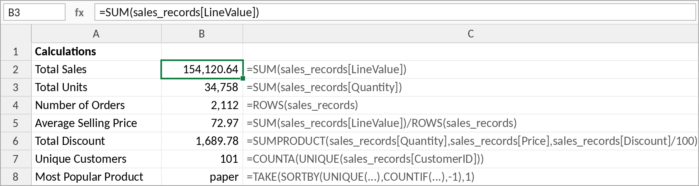

| Measure | Formula |
|---|---|
| Total Sales | `=SUM(sales_records[LineValue])` |
| Total Units | `=SUM(sales_records[Quantity])` |
| Number of Orders | `=ROWS(sales_records)` |
| Average Selling Price | `=SUM(sales_records[LineValue])/ROWS(sales_records)` |
| Total Discount | `=SUMPRODUCT(sales_records[Quantity],sales_records[Price],sales_records[Discount]/100)` |
| Unique Customers | `=COUNTA(UNIQUE(sales_records[CustomerID]))` |
| Most Popular Product | `=TAKE(SORTBY(UNIQUE(sales_records[Product]),COUNTIF(sales_records[Product],UNIQUE(sales_records[Product])),-1),1)` |

**Real-world examples (a credit union)**
- **Monthly board reporting** drew on data from six to eight systems. With Power Query connections, *gathering* the data fell from most of a day to about 40 minutes, and the whole month-end pack went from **1.5–2 days to under half a day** (the analysis itself still takes time).
- A **branch-closing task** went from **15 minutes to 5**: open the file, hit Refresh, save. Across 6 branches, 5 days a week, that saves **about 5 hours every week**.

> **The phrase that pays is "step-by-step instructions".** If you import data into Excel regularly, sit down with your AI assistant and get it to walk you through Power Query. When you hit a problem, take a screenshot, describe it, and ask for help fixing it.

---

## 11. Copilot inside Excel (paid licence)
With a paid Microsoft 365 Copilot licence, a **Copilot** button opens a side panel inside Excel. Since spring 2026 it can **edit the workbook directly** ("let's edit your work"). Because it can see the workbook, **you no longer need to describe your cells**: no cell-by-cell descriptions, no screenshots. It's like standing on the sidelines shouting instructions instead of playing on the pitch yourself.

We used it on a fresh copy of the data file:

| Prompt | Result |
|---|---|
| *Can you add a formula for compound interest to column G?* | It asked whether we wanted the final balance or the interest, then wrote the formula (using LET, as AI often does). There was no need to describe the cells |
| *Can you put checkboxes into column B and make it so that when a checkbox is ticked the corresponding item in column A is crossed out and the colour changed to grey?* | It added the checkboxes and the conditional formatting rule. It greyed the cell **background** rather than the text, because the prompt didn't say which. Be specific |
| *Can you put a lookup into G2 that will show the product name and price for the product in F2? Can you turn F2 into a drop-down?* | XLOOKUP returning **two columns**, plus data validation |

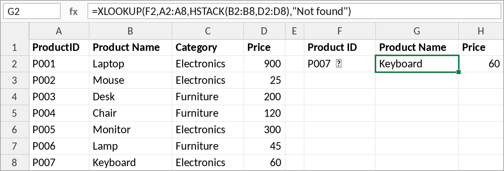

```excel
=XLOOKUP(F2,A2:A8,HSTACK(B2:B8,D2:D8),"Not found")
```

**Is it worth it?**
- Cost: roughly **€30 → €70 per user per month**, which can roughly double what an organisation pays for Excel. That's easier to justify for a small team than for a thousand people.
- Speed: three exercises that took around 40 minutes by hand took **about 4 minutes**. Some small jobs can still be quicker to do yourself, as it can be slow.
- Data: with **Add content** it can work on files in your OneDrive without you uploading copies (see Section 3).
- Risk: when AI does all the work, it's tempting to **stop checking**. Keep checking.

---

## 12. Can AI audit a spreadsheet?
Before uploading, ask yourself: is there anything sensitive in this file? (Section 3.) The course file contains only made-up data, so we uploaded **AI in Excel errors.xlsx** to ChatGPT:

```text
I'm working with Excel. I was given a spreadsheet that has some errors.
Can you identify the errors, explain what's wrong and how to fix them?
```

Reading a whole workbook can take a little while. It found most of the planted errors, plus a few genuine data problems. **Results vary from run to run:** it sometimes finds the checkbox problem in Error3 and sometimes misses it.

| Sheet | Error in the file | Fix |
|---|---|---|
| **Error1** | The conditional format rule should highlight the row with the highest value, but `=$D2=MAX($D$2:$D$11)` only looks at **January**. It appears to work only because the row with the highest value also has the highest January figure. Change a later month to 99,000 and the highlight doesn't move | `=MAX($D2:$O2)=MAX($D$2:$O$11)` |
| **Error2** | Q3 is `=SUM(Sales[May], Sales[Jun], Sales[Jul])`, the wrong months | `=SUM(Sales[Jul], Sales[Aug], Sales[Sep])` |
| **Error3** | The bonus logic `=D2+IF(AND(F2>G2, H2=TRUE), E2, 0)` is fine, but the **old form-control checkboxes** are linked to the wrong cells: 17 controls on 10 rows, and several of them linked to `$H$2`. *(Not always spotted by the AI.)* | Replace them with native checkboxes (Insert > Checkbox) |
| **Error4** | `=SUBTOTAL(9, Expenses[Amount])` vs `=SUM(Expenses[Amount])`: they agree until the table is filtered, because SUBTOTAL ignores hidden rows | Choose the one you actually mean and label it |
| **Error5** | `=F2*(1+N2)` copied down becomes `=F3*(1+N3)`, so only row 2 gets VAT | Anchor the VAT cell: `=F2*(1+$N$2)` |
| **Error5** | The average `=SUM(J2:J12)/COUNT(J2:J11)` includes the **total** in J12 | `=AVERAGE(J2:J11)` |
| **Error5** | Data problems: missing quantity (order 1009), zero quantity (1003), invalid date *33/01/2026* (1008), unknown customer C999 (and a customer number in a different format from the rest), Desk Lamp priced 1.50 in one row and 18.00 in another | Fix at source, or validate as the data comes in |

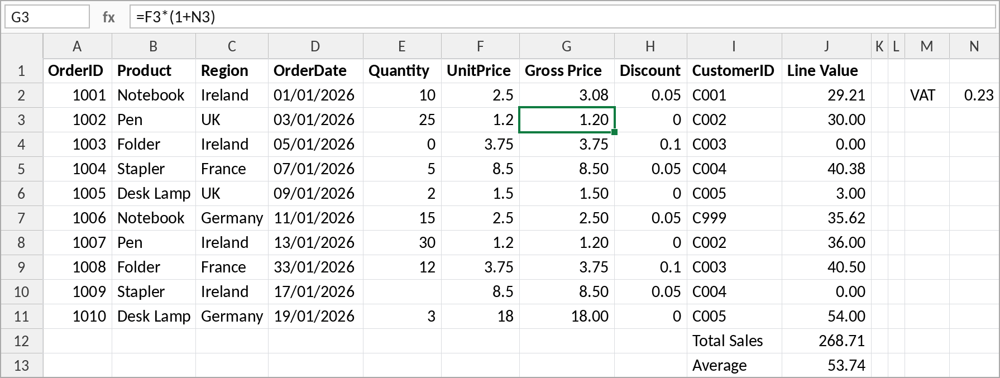

> AI makes a good **first pass** at checking a spreadsheet, but it won't always find every error, and it won't find the same ones every time. A professional review is still needed. Uploading a file and asking for *the answer* is possible, but checking a method you can see is still more trustworthy (Section 1).

---

## 13. Frequently asked questions

**Is there a limit on the free versions?**
Yes. A light user can usually get through a good half-day of questions. File uploads run out sooner: after about four uploads you may be told to come back later. Be wary of solving this with a €20-a-month subscription to every tool going; they add up fast.

**Which is better, ChatGPT or Copilot?**
It keeps changing. At the time of writing (October 2026) ChatGPT is slightly ahead, giving more solid answers, but the landscape shifts constantly. Start with whatever your organisation provides and ask whether it's good enough for what you need. If an answer looks doubtful, put the same question to a second AI and compare.

**Can I upload a big document, like a business case?**
Large files generally work. Whether you *should* depends on how sensitive the content is and which version you're using (Section 3). With paid Copilot and the file in your OneDrive, it's worth trying.

**How do I check a formula on a large data set?**
Build a representative test set and try to break it (Section 9.2).

---

## 14. Summary

**What we got AI to do in Excel**
- Create, explain, debug and rewrite formulas, including LET, SEQUENCE, VSTACK, XLOOKUP, CHOOSECOLS, FILTER, SUMIFS and REGEXEXTRACT
- Build checklists with native checkboxes and conditional formatting, and list the items still to do
- Turn percentages into visual progress bars
- Add XLOOKUP lookups and data-validation dropdowns
- Convert data to tables and use structured references
- Reconcile invoices against bank transactions
- Use Power Query from scratch: import, remove duplicates, replace values, set data types, add calculated columns, refresh
- Build data-driven reports that update when you refresh
- Work directly in the workbook through Copilot in Excel
- Audit an uploaded workbook for errors

**Habits to take away**
1. Give **context** and a **persona**, and ask for **step-by-step instructions**.
2. Always state the **exact cells, sheet, table and column names**. A screenshot is a quick way to do this.
3. Describe **what you want to achieve**, not which feature to use. If you don't know what something is called, ask.
4. Ask for the **method (a formula)** rather than the answer, so you can check it.
5. **One topic, one chat.** Start a new chat when you change subject.
6. **Think before you share.** No sensitive data in free tools; share the structure, not the contents.
7. Expect to **iterate**: show it what went wrong, nudge rather than tell. If a tool struggles, switch tools or start a new chat.
8. **Verify everything**, with a test set on large data. AI is an able assistant, not an infallible oracle.

**Quick reference: useful shortcuts**

| Shortcut | Where | What it does |
|---|---|---|
| **Shift+Enter** | ChatGPT / Copilot prompt box | New line without sending (use it to separate instructions, and the prompt from the data) |
| **Alt+Enter** | Excel formula bar | New line inside a formula |
| **Ctrl+T** | Excel | Convert a range to a table |
