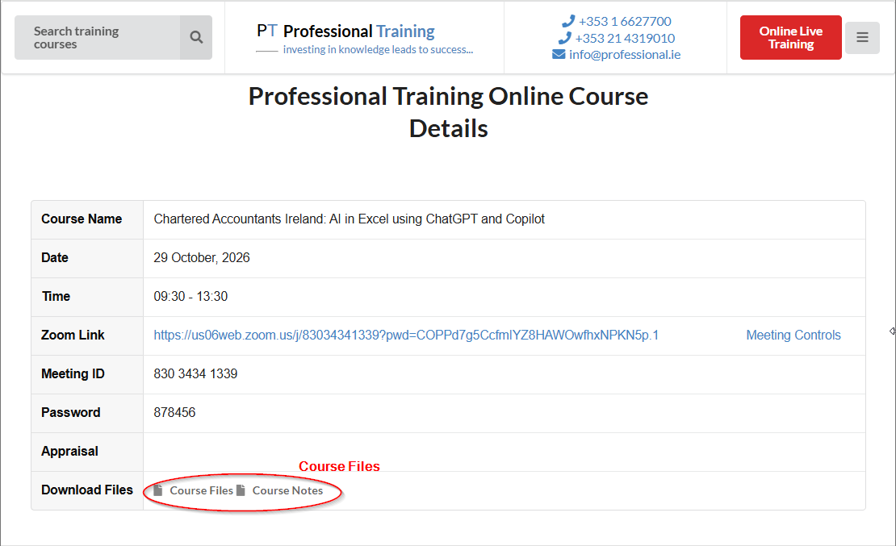

# AI in Excel Using ChatGPT & Copilot — Trainer Manual (October 2026)

This manual explains how to run the course. Use it alongside the two companion documents:

- **Running Order (planned timeline)**: the minute-by-minute schedule. Segment numbers in this manual (e.g. *Segment 10*) match the running order.
- **Course Notes (updated October 2026)**: the participant reference manual, with every prompt, formula and step. Section numbers in this manual (e.g. *Notes §4.4*) refer to the notes.

---

## 1. The audience

This course is designed for members of the **Institute of Chartered Accountants**. Many participants are senior partners in large accountancy firms, financial controllers of large companies and other very senior, very experienced accountants.

What that means for you:

- **Their time is expensive.** Many of them charge by the hour, and they do not like to have their time wasted. Every minute of the course should be visibly useful.
- **They are experts in their own field.** Most are competent, often highly proficient, Excel users. Many are new to AI, and some have never used it at all. Pitch the AI content for beginners, but never talk down to them about Excel or finance.
- **They will judge you quickly.** The first 15 minutes decide whether the room trusts you to use their morning well (see Section 4).

---

## 2. Ground rules for delivery

### Stick to the script
This is a very tightly timed course, so stick as closely to the script as possible. Every part of the course has been scrutinised and agreed between **Professional Training** and the **Institute**: the topics, the exercises, the order and the timings.

- Keep any additions to **anecdotes from your personal experience**: a time AI saved you an afternoon, or a time it confidently got something wrong. These bring the material to life.
- **Do not add new or different topics or exercises**, however useful they seem on the day.
- **Suggestions for additions or changes are welcome**, but they have to be agreed with Professional Training in advance. Send them after the course rather than trying them out live.

### Every session is transcribed and reviewed
**It is a requirement to capture a transcript for every session.** The sessions are **not recorded** — there is no audio or video recording, only the live transcript. After the course, the transcript is fed into AI together with the course outline, with the question: *what was covered, and was anything missed?*

In practice this means:
- Every segment in the running order should be clearly covered. If you shorten something, make sure it is still recognisably there, and say its name ("Now, Power Query…") so the review can identify it.
- Anything added that isn't in the outline will show up too, which is another reason to keep additions to personal anecdotes.

### It's an AI course, not an Excel course
The point of every segment is what **AI** can do for an Excel user. Avoid answering questions from your own Excel expertise; let AI do the heavy lifting. When a participant asks an Excel question, type it into ChatGPT or Copilot in front of them. That answers the question *and* demonstrates the course's core message.

### Zero tolerance for waffle
Keep explanations short and to the point. If you don't know an answer, **don't guess**.

> **Tip:** this is a course on using AI, so if you don't know the answer, ask AI. Do it live, then check the answer with the group. It's a perfect demonstration of "capable assistant, not infallible oracle".

### Start on time and finish on time
- **Starting:** there will usually be stragglers. Give them **no more than 2–3 minutes**, out of respect for the people who arrived on time, then begin.
- **Finishing:** finishing on time is vital. **Do not run over**, even by a few minutes.
- **Finishing early shouldn't happen either.** There is a lot to cover. If the course finishes early, expect requests for refunds for the part that wasn't covered. See Section 8 for managing time.

---

## 3. Before the course

**A day or two before**
- Download the course files (*AI in Excel data.xlsx* and *AI in Excel errors.xlsx*) and run through every segment once.
- Check that the web data sources used in the Power Query segments respond in a browser: `https://api.acodingtutor.com/customers` and `https://api.acodingtutor.com/sales_records`.
- Prepare a **completed copy** of the data file to share in the Zoom chat at the end.
- Copy the longer prompts from the course notes into a document so you can paste them into the Zoom chat quickly.
- Have the **participant list** you were sent open during the course. You will need it to match up anyone whose Zoom display name is abbreviated or masked (see Section 4).
- If you have a paid Microsoft 365 Copilot licence, check the Copilot side panel works in Excel (Segment 26). If not, see Segment 26 for what to do instead.

**On the morning**
- **Log in to the course page and start the session from the Zoom link on that page — never from the Zoom app.** Check the Course Name and Date on the page first: each run of the course has its own page. This is the one thing that must not go wrong; see the warning at the start of Section 4.
- Log in early. Have **ChatGPT**, **Copilot** and **Excel** open and arranged so you can switch between them quickly. Hide the AI side panels to save screen space.
- Start a fresh chat in each AI tool.
- Check **status.openai.com** so you know whether ChatGPT is having a bad day.
- Check that Zoom **live transcription** is set up and working for the session (a short test beforehand is worthwhile). Recording is not used.
- Open the webpage participants use to enter the course, so you can show them where to download the course files.

---

## 4. Opening the course (Segments 1–4, 09:30–09:48)

The opening sets the tone for the whole morning. Done well, it tells the group they're in safe hands and their time won't be wasted.

### ⚠️ Join through the course page — never start the meeting from Zoom

> **You must log in to the same Online Course Details page the participants use, and start the session by clicking the Zoom link on that page.**
>
> **Under no circumstances start the meeting directly from the Zoom app.**

This is not a preference, it is the single most important thing to get right before 09:30. The reasoning is simple: **if you come through the same door as the participants, you cannot end up in the wrong room.** Open a different door — launching from Zoom, a calendar entry, a bookmark, or a link from a previous delivery — and a mistake becomes easy. You can be sitting in an empty meeting while the participants wait in another, and the first you know of it is the phone call.

**Check the page you have open is the right one.** This course runs several times a year, and **every run has its own page**, each with its own Zoom link. Before you click, confirm on the page:

- the **Course Name** is the correct course, and
- the **Date** is today's date.

A page from a previous run looks almost identical and will take you to the wrong meeting. If the name and date don't match, stop and find the correct page before doing anything else.

### Wait for stragglers, briefly
Greet people by name as they arrive. At 09:32–09:33 at the latest, start, whether or not everyone has arrived.

### Start the transcript
**Turn on live transcription before you begin the Trainer Introduction**, so the whole session is captured. Let participants know the session is being transcribed for quality review, and that it is **not being recorded**. Check transcription is still running after the break.

### Trainer Introduction: earn the right (Segment 1)
A strong introduction gives everyone the feeling that they are not going to have their time wasted, and lets you **earn the right** to be there. In 2–3 minutes:

- **Who you are and why you're credible:** your relevant background with Excel, data and AI, in a sentence or two. This is not a CV reading.
- **A concrete example:** one real case where AI made a measurable difference to someone's work.
- **What they'll leave with:** practical techniques they can use at their desk this afternoon.
- **The shape of the course:** a short reality check on AI, then formulas, then intermediate features, then advanced features such as Power Query.

Then cover the opening points in Notes §1: why AI took off in 2022, that you won't go deep into the technology, and that the training data comes mostly from the internet.

### Participant introductions (Segment 2)
This is probably the **main opportunity for audience participation**, so make it count, but keep it moving. Ask each person for four things only:

1. Name
2. Role
3. Excel level
4. AI experience, if any (and which tools they have at work)

Go through the list in order so nobody is missed (Zoom reorders names, so keep track). Thank each person and move on; save follow-up conversations for later in the course. Listen for useful information: who has paid Copilot, who has ChatGPT blocked at work, who is a complete beginner. Refer back to it during the day (e.g. "This is the one for those of you with Copilot at work").

**When display names aren't real names.** Not everyone appears as *Firstname Lastname*. Some join with an abbreviation or initials, and some with nothing useful at all — *iPhone 1234*, *Conference Room 2*, or just *iPad*. This matters, because the attendance record is what their CPD hours depend on.

- You are sent a **participant list before the course** with everyone's name, so in most cases you can work out who is who: match it up as people introduce themselves, and note the pairing as you go.
- If a display name still can't be matched, send that person a **private chat message** asking for their name **"for CPD purposes"**. Framed that way it is a routine administrative request, and people answer it readily.
- Sort it out before the break, since that is when the attendance record is captured (see *CPD attendance record* below). A name fixed afterwards is too late for the screenshot.
- If someone updates their Zoom display name, it changes in the Participants window straight away, which is the easiest outcome for everyone.

### Zoom controls (Segment 3)
Introducing the Zoom controls is important. Polls are an easy way to ask "Has anyone used this feature?" or "Is everyone back from the break?" Show the group:

- **Chat:** where you'll post prompts and links. Ask everyone to say hello in the chat to confirm they can find it.
- **Reactions:** the **Yes** and **No** reactions (sometimes hidden under the "…" menu). Unlike thumbs-up, which disappears after a few seconds, these stay on screen until removed. Ask everyone to find **Yes**, click it and leave it up, and wait until everyone has done so.
- **Questions:** unmute and ask at any time; interruptions are welcome. Ask people to keep cameras on if they can, as nods and puzzled looks help you pace the course.

### The plan for the day (Segment 3)
Outlining the plan is important so everyone knows what they've signed up for. Be explicit:

- It's a **short course with a lot to cover**.
- There's **one 20-minute break, at 11:15**.
- We **finish at 13:30**.
- Participants should **follow along** where they can, and share their screen if they get stuck.
- Show participants how to download the course files from the webpage they used to enter the course, and how to unzip them. Share your screen and walk through it.

The course files are on the same **Online Course Details** page you joined through (pictured at the start of this section), in the **Download Files** row at the bottom: **Course Files** (the workbooks, zipped) and **Course Notes**. Point at that row on your shared screen, and remind people to unzip the download rather than working inside the zip.

### CPD attendance record
Capturing the **list of attendees is a requirement for CPD purposes**. People who don't appear as attending won't get their CPD hours added. It is listed here with the other delivery admin, but it is done later in the morning (see below).

- Open the Zoom **Participants** window and screenshot the **list of names**. This is a record of who attended, nothing more.
- **Names only — never the participants' pictures.** Do not use Gallery view and do not capture camera feeds or profile photos.
- **Take it around the break**, at 11:15 or just after everyone returns at 11:35. By then anyone who joined late is present, so one capture is normally enough.
- If the list is longer than fits on screen, scroll and take a second shot so nobody is missed.
- Check the names will actually identify people before you capture. Chase any masked display names during the first session, not after (see *Participant introductions* above).
- Save with the course name and date, and return as directed by Professional Training.

---

## 5. Running polls with Yes/No reactions

Polls are used throughout the course: "Have you used the LET function?", "Have you used structured references?", "Are you familiar with Power Query?", "Is everyone back from the break?"

**People can be reluctant to leave a reaction on screen for long, particularly when the answer is "no".** Senior people don't enjoy publicly admitting they haven't used something. Make it easy for them:

- **Normalise "no" before you ask.** "Most people on this course haven't come across this, so don't be shy about clicking No."
- **Give the typical result.** Around 80% of people answer no for LET and 80–90% for Power Query; roughly 40–50% say no for structured references. Telling them this afterwards reassures the "no"s that they're in good company.
- **Wait until most people have responded**, then thank them and move on. Don't comment on individuals.
- After the break, ask everyone to click **Yes** when they're back, and start when the reactions are in (or at 11:35, whichever comes first).

---

## 6. Segment-by-segment guide

Times are from the running order. "Notes §" points to the full prompts and steps in the course notes. Use **ChatGPT** for Session 1 and switch to **Copilot** at the start of Session 2, to show that both work equally well.

### Session 1 — Foundations (09:30–11:15)

**Segment 4 · Tools tour (09:44, 4 min) · Notes §1–2**
Show ChatGPT and Copilot side by side. Ask a question with a deliberately misspelt word (e.g. "Azerbijan") to show that AI infers meaning, unlike a search engine. Show the **New chat** button and explain: one topic, one chat.

**Segment 5 · Limitations of AI (09:48, 10 min) · Notes §1**
The reality check. Ask both tools for a numbered list of the countries in Europe and compare the counts. Cover the six limitations, the afternoon slowdown and hallucination (the Cork Tesco example, or one of your own). Land the key message: **a capable assistant, not an infallible oracle**. Keep it brisk; the group wants to get to Excel.

**Segment 6 · Parts of a prompt (09:58, 15 min) · Notes §2**
Walk through the ten parts. Two demonstrations matter most:
- **Context:** "I'm a psychologist. What does NLP stand for?" then, in a new chat, "I'm a computer programmer…"
- **Request:** the ambiguity of "Europe".
Make the point that prompt engineering is really just good human communication. Mention the infographic exercise as an optional follow-up; don't run it in class.

**Segment 7 · Approach (10:13, 3 min) · Notes §1**
Ask AI for the **method**, not the answer: a formula can be checked; an answer has to be re-done to be checked.

**Segment 8 · Create a formula (10:16, 5 min) · Notes §4.1**
Compound interest. Type the prompt live, naming every cell. Paste the result into G2, then **sanity-check it out loud** (5% of €100,000 over 5 years ≈ €25,000 plus compounding). Point out that AI plugs your cell references in for you.

**Segment 9 · Explain & debug a formula (10:21, 6 min) · Notes §4.2–4.3**
Paste the ExcelJet combine-ranges formula and ask what it does. Paste it into a sheet to get `#NAME?`, and ask AI to fix it. If AI asks which version of Excel you're using, answer it.

**Segment 10 · LET deep dive (10:27, 12 min) · Notes §4.4**
Poll: "Have you used LET?" Rebuild the formula one step at a time (Alt+Enter between steps). Then ask AI to rewrite it without LET and point out the repetition. **Start a new chat afterwards** and explain why: otherwise AI keeps avoiding LET. The message is not "use LET" but "recognise it, because AI uses it a lot".

**Segment 11 · To-do checklist (10:39, 10 min) · Notes §5**
The prompt describes the result and doesn't name conditional formatting; point this out. Follow the steps exactly as AI gives them. If anyone gets a Developer-tab answer, use it as a live example of out-of-date information. Finish with the "items remaining" formula.

**Segment 12 · Exercise: Progress tracker (10:49, 8 min) · Notes §7**
The hands-on exercise. Give clear instructions, then let participants work. Watch for people who are stuck and offer to look at their shared screen. Bring everyone back on time and show the visual extension yourself. If AI suggests data bars, show the scale fix (Number 0–1).

**Segment 13 · XLOOKUP + dropdown (10:57, 10 min) · Notes §6**
Demonstrate the **screenshot** technique; it's one of the most valued tips of the day. Test the formula, including a product ID that doesn't exist. Cover XLOOKUP vs VLOOKUP briefly (many in the room are VLOOKUP loyalists, so be respectful). Return two columns, then turn F2 into a dropdown.

**Segment 14 · Keeping your data safe (11:07, 5 min) · Notes §3**
Follows naturally from the screenshot tip. This audience handles client and company data and will be thinking about it. Cover what not to share with free tools, how to share the structure instead of the data, and paid Copilot with OneDrive. Tell them to check their organisation's AI policy.

**Segment 15 · Recap (11:12, 3 min)**
Three minutes, no more. Then the break: back at **11:35**.

### Session 2 — Intermediate & Advanced (11:35–13:30)

**Segment 16 · Excel Tables & structured references (11:35, 17 min) · Notes §8**
Switch to Copilot (new chat, context and persona). Most participants have seen tables, so move quickly through Ctrl+T and styles. Spend the time on what people miss: **naming the table**, auto-expansion, and **structured references**. Poll on structured references, then ask AI "What is this called and how does it work?" to model learning a feature by name. Finish with the cross-sheet comparison.

**Segment 17 · Extract invoice number (11:52, 10 min) · Notes §9.1**
Expect AI's first attempts to struggle with the word "invoice". That's the lesson: iterate. Feed back a screenshot with the failing rows named, then nudge ("Isn't there a better way to match a pattern?") rather than telling it the answer. Land on REGEXEXTRACT.

**Segment 18 · Validating a formula on large data (12:02, 3 min) · Notes §9.2**
Participants will be wondering how to trust a formula across 10,000 rows. Cover test sets, sampling, grouping by pattern and trying to break it.

**Segment 19 · Unmatched invoices (12:05, 10 min) · Notes §9.3**
If you ask before converting to tables, the formula uses a fixed range and misses a newly added invoice. Use this to show *why* tables matter, then convert both lists and name them. Test by changing the data.

**Segment 20 · Full reconciliation (12:15, 10 min) · Notes §9.4**
Not paid, underpaid, overpaid, paid in full. Use the exact column and table names in your prompt. If AI names a column differently from yours, point it out as a teaching moment.

**Segment 21 · Power Query intro (12:25, 5 min) · Notes §10**
Poll: "Are you familiar with Power Query?" Start a **new chat** and explain why (otherwise the answer is coloured by the reconciliation). Frame the segment as a test: can AI take someone who has never used a feature to using it, with only step-by-step instructions?

**Segment 22 · Web import (12:30, 10 min) · Notes §10.1**
Explain JSON in one minute. Follow AI's steps exactly. Where the screen doesn't match the instructions (e.g. the To Table dialog, or the prefix tick box), say so and show how you'd handle it.

**Segment 23 · Refresh & cleaning (12:40, 10 min) · Notes §10.1–10.2**
Add a record at source and refresh. Delete a duplicate by hand, refresh, and watch it come back; then fix it in Power Query. Same for Ireland / Republic of Ireland. Message: fix data on the way in, never after.

**Segment 24 · Data types, calculated columns & reports (12:50, 8 min) · Notes §10.3–10.4**
Show data types, the LineValue custom column and the Calculations tab updating on Refresh All.

**Segment 25 · Power Query wrap-up (12:58, 2 min) · Notes §10.4**
"Step-by-step instructions" is the phrase that pays. Share the credit-union examples, or a real example of your own.

**Segment 26 · Copilot in Excel (13:00, 8 min) · Notes §11**
Show the side panel doing the morning's exercises without any description of the cells. Be balanced about the cost; some participants will be making buying decisions. If you don't have a licence, walk through the examples in the notes instead and use the spare time for Q&A.

**Segment 27 · Upload a file to find errors (13:08, 8 min) · Notes §12**
Say out loud that you've checked the file isn't sensitive before uploading. Walk through what AI finds, and note that results vary between runs.

**Segment 28 · Wrap-up (13:16, 7 min) · Notes §14**
Recap the limitations, the parts of a prompt, everything AI did, and the habits to take away. Share the completed file in the chat.

**Segment 29 · Q&A (13:23, 7 min) · Notes §13**
Take questions. Common ones are free-tier limits, ChatGPT vs Copilot, and uploading large documents. At **13:30**, thank everyone and close, even if questions remain; offer to stay on for anyone who wants to continue.

---

## 7. Handling questions

- **Excel questions:** ask AI live rather than answering from your own knowledge (Section 2).
- **Questions you can't answer:** don't guess; ask AI and check the answer with the group.
- **Questions outside the course scope:** acknowledge them, answer in a sentence if you can, and offer to pick them up at the end or after the course. Don't let them take the course off-script.
- **Long or individual problems:** offer to look at them during the break or after 13:30.
- **Keep answers short.** A good answer to a senior audience is a direct answer.

---

## 8. Managing time

### Checkpoints
Check these as you go. If you're more than a few minutes off at any checkpoint, adjust straight away rather than hoping to catch up later.

| By | You should be starting |
|---|---|
| 09:33 | Trainer Introduction (at the latest) |
| 09:58 | Parts of a prompt |
| 10:16 | Create a formula |
| 10:49 | Progress tracker exercise |
| 11:15 | **Coffee break** |
| 11:35 | Excel Tables |
| 12:05 | Unmatched invoices |
| 12:25 | Power Query intro |
| 13:00 | Copilot in Excel |
| 13:16 | Wrap-up |
| 13:30 | **Finish** |

### If you're running behind
Shorten, don't skip whole topics. These parts can be trimmed and referred to the notes without losing the thread of the course:
- the LET rewrite at the end of Segment 10
- the "items remaining" extension in Segment 11
- data types and calculated columns in Segment 24

### If you're running ahead
This shouldn't happen. If it does, use the time within the agreed content: more testing of formulas, an extra iteration with AI, a comparison of the same prompt in both tools, or more time on participants' questions. Do not add new topics or exercises, and do not finish early.

---

## 9. When AI has a bad day

AI is non-deterministic and some days it is slow or gives weak answers, especially in the afternoon. That is part of the course message, so handle it calmly and in the open:

- **Iterate:** tell it what went wrong, with a screenshot if possible.
- **Start a new chat:** long conversations drift.
- **Switch tools:** if ChatGPT is struggling, use Copilot, or vice versa.
- **Keep the clock in mind:** if a formula isn't working after two or three attempts, show the working version from the course notes, explain that this is what you'd normally get, and move on.

---

## 10. After the course

- Return the CPD attendance record as directed by Professional Training.
- Save the **session transcript** and return it as directed by Professional Training. It will be reviewed with AI against the course outline to check what was covered and whether anything was missed.
- Send any suggestions for changes or additions to Professional Training. Remember they must be agreed in advance of the next delivery.
- Note anything that didn't work as expected (e.g. a changed Excel menu, a website that didn't respond) so the notes can be updated.

---

## Appendix: one-page checklist

**Before**
- [ ] Course files downloaded and every segment rehearsed
- [ ] Web data sources checked
- [ ] Completed file ready to share
- [ ] Prompts ready to paste
- [ ] ChatGPT, Copilot and Excel open; fresh chats started
- [ ] status.openai.com checked
- [ ] Zoom live transcription tested

**Opening**
- [ ] **Correct course page open** — Course Name and Date checked against today
- [ ] **Session started from the Zoom link on that page**, not from the Zoom app
- [ ] **Live transcription started** before the Trainer Introduction
- [ ] Started by 09:33
- [ ] Trainer Introduction: earn the right
- [ ] Participant introductions: name, role, Excel level, AI experience
- [ ] Masked display names (*iPhone 1234*) matched to the participant list, or chased by private chat
- [ ] Chat and Yes/No reactions introduced
- [ ] Plan for the day: 20-minute break at 11:15, finish at 13:30

**During**
- [ ] On script; anecdotes only, no new topics
- [ ] Excel questions answered by AI
- [ ] Timing checkpoints met
- [ ] Break at 11:15, restart at 11:35 (transcription still running)
- [ ] **CPD attendance record taken** at the break (Participants window, names only)

**Close**
- [ ] Completed file shared in chat
- [ ] Finished at 13:30, not before, not after
- [ ] CPD attendance record and **session transcript** returned; suggestions sent to Professional Training
